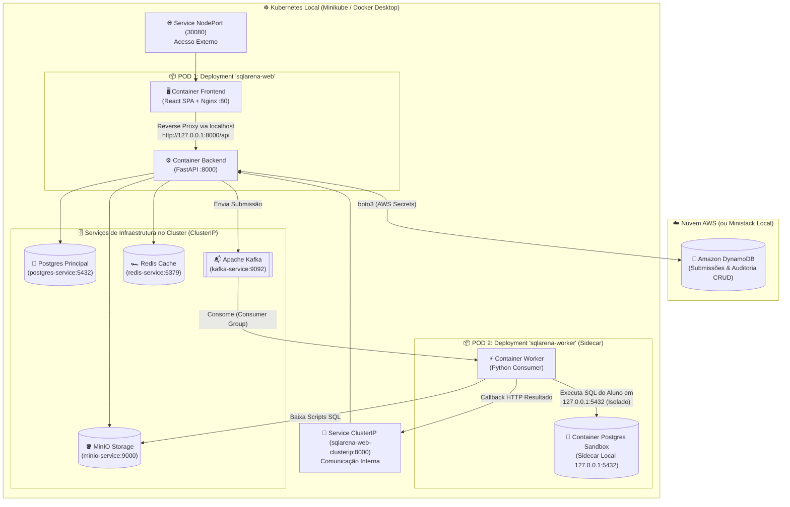

# ⚔️ SQLArena - Plataforma Distribuída de Ensino e Avaliação de SQL

Plataforma distribuída para aprendizado e avaliação automatizada de consultas SQL, com execução assíncrona orientada a eventos, isolamento em sandbox relacional, cache em memória e persistência distribuída.

---

## 🏛️ 1. Arquitetura da Aplicação

A arquitetura do SQLArena é composta por microsserviços e serviços de dados conteinerizados:

| Componente / Camada | Tecnologia | Função na Aplicação |
| :--- | :--- | :--- |
| **Banco NoSQL** | **Amazon DynamoDB** (AWS ou Ministack) | Persistência imutável do histórico de submissões (`sqlarena-submissions-log`) e auditoria de ações administrativas (`sqlarena-crud-actions-log`). |
| **Banco Relacional Principal** | **PostgreSQL 16** (`postgres:16-alpine`) | Persistência relacional de usuários, catálogo de categorias N:N, questões e pontuações consolidadas. |
| **Armazenamento de Objetos** | **MinIO** (`elestio/minio:latest`) | Armazenamento S3-compatible de scripts SQL de cada exercício (`schema.sql`, `data.sql`, `answer.sql`) e avatares de usuários. |
| **Mensageria Assíncrona** | **Apache Kafka** (`apache/kafka:3.8.0`) | Broker em modo KRaft com tópicos particionados (`sqlarena-submissions-queue`), Consumer Groups e Dead Letter Queue (DLQ). |
| **Cache & Rate Limit** | **Redis 7** (`redis:7-alpine`) | Controle de taxa de submissão (5s por usuário), cache de ranking global e estado de processamento em tempo real. |
| **Backend API & Worker** | **`app/Dockerfile`** (Python 3.11 / FastAPI) | API RESTful com autenticação JWT, validação de regras de negócio, health check real e motor worker de avaliação de queries. |
| **Frontend Web** | **`frontend/Dockerfile`** (React 19 / Nginx) | SPA em React 19 com Monaco Editor, Tailwind CSS e Nginx atuando como reverse proxy para a API. |

---

## 📂 2. Estrutura de Diretórios do Projeto

```text
SQLArena/
├── app/
│   ├── Dockerfile              # Imagem unificada do Backend (FastAPI) e Worker
│   ├── entrypoint.sh           # Script de inicialização fail-fast e seed automático (--if-empty)
│   ├── api/                    # Endpoints REST (auth, questions, submissions, audit, users, ranking)
│   ├── cache/                  # Cliente Redis (Rate Limit de 5s e cache de ranking)
│   ├── database/               # PostgreSQL Principal (models SQLAlchemy, seed.py idempotente)
│   ├── dynamodb/               # Cliente oficial do Amazon DynamoDB (AWS Boto3)
│   ├── kafka/                  # Gerenciador do Apache Kafka (com commits e retries resilientes)
│   ├── minio/                  # Gerenciador do MinIO S3-Compatible
│   ├── worker/                 # Motor de avaliação em Sandbox PostgreSQL
│   ├── config.py               # Variáveis e configurações Pydantic
│   └── main.py                 # Ponto de entrada FastAPI com health check real
├── frontend/
│   ├── Dockerfile              # Imagem Multi-Stage (Node 20 Build -> Nginx 1.27 Alpine)
│   ├── nginx.conf.template     # Template Nginx com proxy dinâmico para /api
│   └── src/                    # SPA React 19, Tailwind CSS v4 e Monaco Editor
├── k8s/                        # Manifestos Kubernetes Locais
│   ├── 01-configmap.yaml       # Variáveis de ambiente não-sensíveis (com suporte a AWS ou Ministack)
│   ├── 02-secrets.yaml         # Secrets (senhas Postgres, MinIO e chaves AWS DynamoDB)
│   ├── 03-postgres-main.yaml   # Deployment + PVC + Service ClusterIP do Postgres Principal
│   ├── 04-redis.yaml           # Deployment + Service ClusterIP do Redis
│   ├── 05-minio.yaml           # Deployment + PVC + Service ClusterIP e NodePort (30901) do MinIO
│   ├── 06-kafka.yaml           # Deployment + Service ClusterIP do Apache Kafka (KRaft)
│   ├── 07-web-pod.yaml         # POD 1 (Frontend + Backend) + Services NodePort (30080) e ClusterIP
│   ├── 08-worker-pod.yaml      # POD 2 (Worker + Postgres Sandbox Sidecar) + Service ClusterIP
│   └── 09-hpa.yaml             # HorizontalPodAutoscaler (HPA) para escalabilidade dos Pods
├── terraform/                  # Infraestrutura como Código para o DynamoDB
│   ├── modules/dynamodb/       # Módulo com as tabelas de submissões e auditoria CRUD
│   ├── envs/credentials.tfvars.example # Modelo para credenciais da AWS
│   ├── envs/local.tfvars       # Variáveis para Ministack local (porta 4566)
│   ├── main.tf                 # Definição dos recursos DynamoDB
│   ├── variables.tf            # Declaração de variáveis
│   ├── outputs.tf              # Nomes e ARNs das tabelas
│   └── providers.tf            # Provedor AWS
├── ministack/                  # Emulador local de serviços AWS (para execução offline do DynamoDB)
│   └── docker-compose.yml      # Ministack na porta 4566
├── docker-compose.yml          # Orquestração principal de TODOS os containers da aplicação
└── .env.example                # Modelo de variáveis de ambiente
```

---

## 📋 GUIA DE EXECUÇÃO SEQUENCIAL

Siga rigorosamente os passos abaixo para configurar e executar o projeto.

---

### PASSO 1: Configurar a Camada NoSQL (Amazon DynamoDB)

A primeira etapa consiste em definir se a aplicação utilizará o **Amazon DynamoDB na nuvem da AWS** ou o **emulador local offline (Ministack)**.

Primeiro, crie o arquivo `.env` na raiz do projeto copiando o modelo de exemplo:

```powershell
# Windows (PowerShell):
Copy-Item .env.example .env

# Linux / macOS:
cp .env.example .env
```

Agora, escolha **uma** das duas opções a seguir para o DynamoDB:

---

#### 🟢 OPÇÃO 1.A: Utilizar o Amazon DynamoDB Oficial na AWS

1. **Provisionar as tabelas no DynamoDB via Terraform:**
   * Acesse o diretório de variáveis do Terraform e copie o modelo:
     ```powershell
     cd terraform/envs
     Copy-Item credentials.tfvars.example credentials.tfvars
     ```
   * Abra o arquivo `credentials.tfvars` e insira suas credenciais ativas da AWS (`aws_access_key`, `aws_secret_key` e `aws_session_token`).
   * Retorne à pasta `terraform` e aplique o plano:
     ```powershell
     cd ..
     terraform init
     terraform apply -var-file="envs/credentials.tfvars" -auto-approve
     cd ..
     ```
     *(As tabelas `sqlarena-submissions-log` e `sqlarena-crud-actions-log` serão criadas na AWS).*

2. **Preencher o arquivo `.env` na raiz do projeto:**
   Abra o `.env` e configure suas credenciais da AWS:
   ```env
   AWS_REGION=us-east-1
   AWS_ACCESS_KEY_ID=ASIA...
   AWS_SECRET_ACCESS_KEY=...
   AWS_SESSION_TOKEN=IQoJb3JpZ2luX2VjE...
   DYNAMODB_ENDPOINT_URL=
   ```
   *(Mantenha `DYNAMODB_ENDPOINT_URL=` vazio para conectar diretamente aos servidores da AWS).*

---

#### 🟡 OPÇÃO 1.B: Execução 100% Offline (Sem AWS, via Ministack)

1. **Configurar o arquivo `.env` na raiz primeiro:**
   Abra o arquivo `.env` e ajuste as variáveis para apontar para o container do Ministack local:
   ```env
   AWS_REGION=us-east-1
   AWS_ACCESS_KEY_ID=test
   AWS_SECRET_ACCESS_KEY=test
   AWS_SESSION_TOKEN=
   DYNAMODB_ENDPOINT_URL=http://host.docker.internal:4566
   ```

2. **Iniciar o container do Ministack:**
   Execute no terminal para inicializar o emulador local na porta `4566`:
   ```powershell
   docker compose -f ministack/docker-compose.yml up -d
   ```

*(Nota: O backend da aplicação detecta o Ministack e inicializa as tabelas automaticamente no primeiro boot).*

---

### PASSO 2: Escolha a Plataforma de Execução

Com o DynamoDB configurado no **Passo 1**, escolha o método de execução da aplicação:

* **[Caminho A: Docker Compose](#-caminho-a-executar-via-docker-compose)** (Execução unificada de todos os containers)
* **[Caminho B: Kubernetes Local](#-caminho-b-executar-via-kubernetes-local)** (Orquestração via Pods Multi-Container, Services e HPA)

---

### 🐳 CAMINHO A: Executar via Docker Compose

O arquivo [`docker-compose.yml`](docker-compose.yml) orquestra de forma integrada todos os 8 containers:
- `sqlarena-postgres`: PostgreSQL 16 Principal (porta `15432`)
- `sqlarena-postgres-sandbox`: PostgreSQL 16 Sandbox isolado para queries de alunos (porta `15433`)
- `sqlarena-redis`: Redis 7 (porta `16379`)
- `sqlarena-minio`: MinIO Object Storage (porta `9000` / Console `9001`)
- `sqlarena-kafka`: Apache Kafka 3.8 em modo KRaft (porta `9092`)
- `sqlarena-backend`: API FastAPI na porta `8000` (com seed automático seguro `--if-empty`)
- `sqlarena-worker`: Consumidor assíncrono do Kafka
- `sqlarena-frontend`: React SPA servida via Nginx na porta `80` (e `5173`)

#### 1. Iniciar toda a aplicação com 1 comando:
Na raiz do projeto (`SQLArena/`), execute:
```powershell
docker compose up -d --build
```

O comando irá construir as imagens locais, aguardar os health checks das dependências e iniciar a API, o Worker e o Frontend.

#### 2. Verificar o status dos containers:
```powershell
docker compose ps
```
Todos os containers devem exibir o status **`Up (healthy)`** ou **`Up`**.

#### 3. Para pausar ou resetar a aplicação:
* **Pausar mantendo os dados salvos:**
  ```powershell
  docker compose down
  ```
* **Resetar completamente (apagar containers, volumes e redes locais):**
  ```powershell
  docker compose down -v
  ```

---

### ☸️ CAMINHO B: Executar via Kubernetes Local

A aplicação disponibiliza manifestos para execução em clusters locais (**Docker Desktop com Kubernetes ativado** ou **Minikube**) utilizando topologia de Pods Multi-Container:



* **POD 1 — `sqlarena-web` (`k8s/07-web-pod.yaml`):** Co-localiza o **Frontend** e o **Backend** no mesmo Pod. O Nginx atende na porta `80` e repassa requisições `/api` via loopback interno (`http://127.0.0.1:8000`). Exposto externamente via Service **NodePort** (`30080`) e internamente via Service **ClusterIP**.
* **POD 2 — `sqlarena-worker` (`k8s/08-worker-pod.yaml`):** Padrão **Sidecar** co-localizando o **Worker Python** e o **PostgreSQL Sandbox** isolado (`127.0.0.1:5432`). Ao escalar via HPA, cada réplica ganha seu próprio sandbox independente.

#### 1. Iniciar o cluster local:
* **No Docker Desktop:** Abra Settings -> **Kubernetes** -> Marque **Enable Kubernetes** -> **Apply & restart**.
* **Ou no Minikube:** Execute no terminal:
  ```powershell
  minikube start --driver=docker
  ```

#### 2. Configurar o Kubernetes conforme o modo de DynamoDB escolhido no Passo 1:
O cluster opera de forma transparente tanto com a AWS real quanto com o Ministack local:
* **Se escolheu a AWS Real (Opção 1.A):**
  Abra [`k8s/02-secrets.yaml`](k8s/02-secrets.yaml) e preencha suas credenciais ativas da AWS:
  ```yaml
  AWS_ACCESS_KEY_ID: "ASIA..."
  AWS_SECRET_ACCESS_KEY: "..."
  AWS_SESSION_TOKEN: "IQoJ..."
  ```
  *(O arquivo `k8s/01-configmap.yaml` já possui `DYNAMODB_ENDPOINT_URL: ""` por padrão).*
* **Se escolheu o Ministack Offline (Opção 1.B):**
  Em [`k8s/02-secrets.yaml`](k8s/02-secrets.yaml), defina:
  ```yaml
  AWS_ACCESS_KEY_ID: "test"
  AWS_SECRET_ACCESS_KEY: "test"
  AWS_SESSION_TOKEN: ""
  ```
  E em [`k8s/01-configmap.yaml`](k8s/01-configmap.yaml), defina:
  ```yaml
  DYNAMODB_ENDPOINT_URL: "http://host.docker.internal:4566"
  ```

#### 3. Aplicar os manifestos no Kubernetes:
Na raiz do projeto, execute:
```powershell
kubectl apply -f k8s/
```

#### 4. Verificar Pods e Services:
```powershell
# Verifique se todos os Pods estão 'Running' (observe READY 2/2 nos Pods Web e Worker):
kubectl get pods

# Listar os Services (NodePort e ClusterIP):
kubectl get services

# Inspecionar o auto-scaling dos Pods (HPA):
kubectl get hpa
```

#### 5. Para encerrar o Kubernetes:
```powershell
kubectl delete -f k8s/
```

---

### PASSO 3: Acessar a Aplicação no Navegador

Após a inicialização (seja por **Docker Compose** ou **Kubernetes**), acesse os serviços:

| Serviço | URL via Docker Compose | URL via Kubernetes (NodePort) | Credenciais de Acesso |
| :--- | :--- | :--- | :--- |
| **Plataforma Web (Frontend)** | [http://localhost](http://localhost) (ou `:5173`) | [http://localhost:30080](http://localhost:30080) | *(Ver Passo 4)* |
| **Documentação da API (Swagger)** | [http://localhost:8000/docs](http://localhost:8000/docs) | [http://localhost:30800/docs](http://localhost:30800/docs) | Acesso livre |
| **Console Web do MinIO Storage** | [http://localhost:9001](http://localhost:9001) | [http://localhost:30901](http://localhost:30901) | **Usuário:** `minioadmin`<br>**Senha:** `minioadmin123` |

*(Nota para usuários de Minikube: caso as portas NodePort não abram diretamente pelo localhost, execute `minikube service sqlarena-web-nodeport` para abrir o túnel).*

---

### PASSO 4: Credenciais Pré-configuradas para Teste

O seed da aplicação cadastra automaticamente dois perfis para validação do sistema:

| Papel | Email | Senha | Operações Disponíveis |
| :--- | :--- | :--- | :--- |
| **Aluno** | `gustavo@sqlarena.com` | `123456` | Acessar catálogo com 21 exercícios de SQL, redigir consultas no editor interativo Monaco, submeter queries para avaliação assíncrona, receber diagnóstico em tempo real e visualizar ranking geral. |
| **Instrutor** | `admin@sqlarena.com` | `123456` | Criar novas questões com validação automática de scripts SQL (DDL, DML e gabarito), gerenciar status de publicação/exclusão e consultar logs de auditoria no DynamoDB. |

---

### PASSO 5: Executar a Suíte de Testes Automatizados

Para validar o funcionamento dos serviços, segurança de callback, health check e Kafka:

* **Se estiver executando com Docker Compose:**
  ```powershell
  # Testes de segurança, autenticação de callback, resiliência do Kafka e healthcheck real:
  docker exec sqlarena-backend pytest app/testes/test_security_and_reliability.py -v

  # Execução de todos os testes unitários e de integração:
  docker exec sqlarena-backend pytest app/testes/ -v
  ```

* **Se estiver executando no Kubernetes:**
  ```powershell
  kubectl exec -it deployment/sqlarena-web -c backend -- pytest app/testes/test_security_and_reliability.py -v
  ```

---

### PASSO 6: Limpeza e Finalização (Tear Down)

Ao encerrar os testes:

1. **Se utilizou a AWS Real (Terraform):**
   Para evitar custos na sua conta AWS, destrua as tabelas do DynamoDB:
   ```powershell
   cd terraform
   terraform destroy -var-file="envs/credentials.tfvars" -auto-approve
   cd ..
   ```
2. **Se utilizou o Docker Compose:**
   ```powershell
   docker compose down -v
   ```
3. **Se utilizou o Ministack local:**
   ```powershell
   docker compose -f ministack/docker-compose.yml down -v
   ```
4. **Se utilizou o Kubernetes:**
   ```powershell
   kubectl delete -f k8s/
   ```
