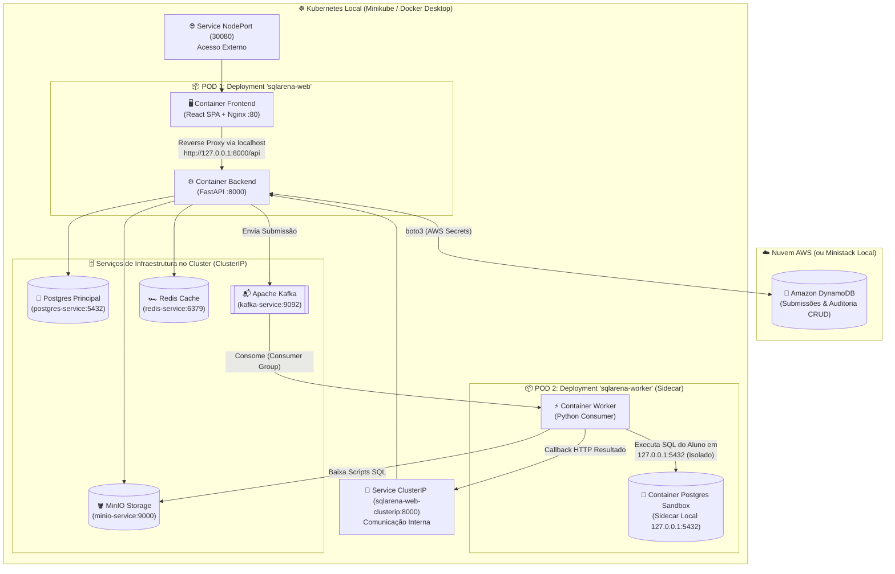

# ⚔️ SQLArena - Plataforma Distribuída de Ensino e Avaliação de SQL

> **Trabalho Prático 2 — Desenvolvimento de Software para Nuvem (UFC)**  
> **Professores:** Dr. Paulo A. L. Rego e Dr. Fernando Antonio Mota Trinta  
> **Objetivo:** Implantação da aplicação desenvolvida no Trabalho 1 utilizando **Docker**, **Docker Compose** e **Kubernetes**.

---

## 🏛️ 1. Arquitetura da Aplicação e Substituições de Serviços

Neste Trabalho Prático 2, todos os serviços que antes eram gerenciados pela AWS (RDS, S3, SQS e ElastiCache) foram **migrados para containers gerenciados localmente**, mantendo apenas o **Amazon DynamoDB** como banco NoSQL na nuvem (conforme a especificação do trabalho):

| Serviço / Camada | Tecnologia Atual | O que substitui | Função na Aplicação |
| :--- | :--- | :--- | :--- |
| **Banco NoSQL (AWS)** | **Amazon DynamoDB** | *Mantido na AWS* | Persiste de forma imutável o histórico de submissões (`sqlarena-submissions-log`) e a auditoria de ações de CRUD (`sqlarena-crud-actions-log`). |
| **Banco Relacional Principal** | **PostgreSQL 16** (`postgres:16-alpine`) | Amazon RDS | Container gerenciado pela equipe com volume persistente. Armazena usuários, categorias N:N, questões e pontuação (+10 XP). |
| **Armazenamento de Arquivos** | **MinIO** (`elestio/minio:latest`) | Amazon S3 | Container compatível com API S3 (`boto3`). Armazena scripts SQL puros de cada questão (`schema.sql`, `data.sql`, `answer.sql`) e avatares. |
| **Fila de Mensagens Assíncrona**| **Apache Kafka** (`apache/kafka:3.8.0`) | Amazon SQS | Broker em modo **KRaft** (sem Zookeeper). Tópico particionado (`sqlarena-submissions-queue`) com Consumer Group e Dead Letter Queue (DLQ). |
| **Cache & Rate Limit** | **Redis 7** (`redis:7-alpine`) | Amazon ElastiCache | Rate Limit de 5 segundos por aluno, cache de ranking e status em tempo real. |
| **Backend & Worker** | **`app/Dockerfile`** | Golden AMIs | Imagem Python 3.11 com FastAPI (API REST + seed automático `--if-empty`) e o Worker de avaliação. |
| **Frontend** | **`frontend/Dockerfile`** | Golden AMIs | Build Multi-Stage (Node 20 -> Nginx 1.27 Alpine) servindo React 19 SPA com Reverse Proxy para `/api`. |

---

## 📂 2. Estrutura de Arquivos do Projeto

```text
SQLArena/
├── app/
│   ├── Dockerfile              # Imagem unificada do Backend (FastAPI) e Worker
│   ├── entrypoint.sh           # Script de inicialização fail-fast e seed automático (--if-empty)
│   ├── api/                    # Endpoints REST (auth, questions, submissions, audit, users, ranking)
│   ├── cache/                  # Cliente Redis (Rate Limit de 5s e cache de ranking)
│   ├── database/               # PostgreSQL Principal (models SQLAlchemy, seed.py idempotente)
│   ├── dynamodb/               # Cliente oficial do Amazon DynamoDB (AWS)
│   ├── kafka/                  # Gerenciador do Apache Kafka (com commits e retries resilientes)
│   ├── minio/                  # Gerenciador do MinIO S3-Compatible (substituindo S3)
│   ├── worker/                 # Motor de avaliação em Sandbox PostgreSQL
│   ├── config.py               # Variáveis e configurações Pydantic
│   └── main.py                 # Ponto de entrada FastAPI com health check real
├── frontend/
│   ├── Dockerfile              # Imagem Multi-Stage (Node 20 Build -> Nginx 1.27 Alpine)
│   ├── nginx.conf.template     # Template Nginx com proxy dinâmico para /api
│   └── src/                    # SPA React 19, Tailwind CSS v4 e Monaco Editor
├── k8s/                        # Manifestos Kubernetes Locais (Bônus de 1 ponto)
│   ├── 01-configmap.yaml       # Variáveis de ambiente não-sensíveis (com suporte a AWS ou Ministack)
│   ├── 02-secrets.yaml         # Secrets (senhas Postgres, MinIO e chaves AWS DynamoDB)
│   ├── 03-postgres-main.yaml   # Deployment + PVC + Service ClusterIP do Postgres Principal
│   ├── 04-redis.yaml           # Deployment + Service ClusterIP do Redis
│   ├── 05-minio.yaml           # Deployment + PVC + Service ClusterIP e NodePort (30901) do MinIO
│   ├── 06-kafka.yaml           # Deployment + Service ClusterIP do Apache Kafka (KRaft)
│   ├── 07-web-pod.yaml         # POD 1 (Frontend + Backend) + Services NodePort (30080) e ClusterIP
│   ├── 08-worker-pod.yaml      # POD 2 (Worker + Postgres Sandbox Sidecar) + Service ClusterIP
│   └── 09-hpa.yaml             # HorizontalPodAutoscaler (HPA) para escalabilidade dos Pods
├── terraform/                  # Infraestrutura como Código exclusiva para o DynamoDB
│   ├── modules/dynamodb/       # Módulo com as tabelas de submissões e auditoria CRUD
│   ├── envs/credentials.tfvars.example # Modelo para AWS Academy
│   ├── envs/local.tfvars       # Variáveis para Ministack local (porta 4566)
│   ├── main.tf                 # Criação das tabelas DynamoDB
│   ├── variables.tf            # Declaração de variáveis
│   ├── outputs.tf              # Nomes e ARNs das tabelas
│   └── providers.tf            # Provedor AWS
├── ministack/                  # Emulador local de serviços AWS (para teste offline do DynamoDB)
│   └── docker-compose.yml      # Ministack na porta 4566
├── docker-compose.yml          # Orquestração principal de TODOS os 8 containers da aplicação
└── .env.example                # Modelo de variáveis de ambiente
```

---

## 📋 GUIA DE EXECUÇÃO SEQUENCIAL PASSO A PASSO

Siga rigorosamente a ordem abaixo para subir a aplicação do zero.

---

### PASSO 1: Configurar a Camada NoSQL (Amazon DynamoDB)

Como o **DynamoDB** é o único serviço externo mantido, a primeira decisão é definir se você irá se conectar ao DynamoDB oficial na **nuvem da AWS** ou emulá-lo **localmente de forma 100% offline** via Ministack.

Primeiro, gere o arquivo de configuração `.env` na raiz do projeto:

```powershell
# Windows (PowerShell):
Copy-Item .env.example .env

# Linux / macOS:
cp .env.example .env
```

Agora, escolha **uma** das duas opções a seguir:

---

#### 🟢 OPÇÃO 1.A: Usar Amazon DynamoDB Real na AWS (Recomendado)

Se você tem acesso à AWS (ex: conta do AWS Academy Learner Lab):

1. **Criar as tabelas no DynamoDB via Terraform:**
   * Vá até a pasta `terraform/envs/`:
     ```powershell
     cd terraform/envs
     Copy-Item credentials.tfvars.example credentials.tfvars
     ```
   * Abra `credentials.tfvars` e cole suas credenciais ativas do AWS Academy (`aws_access_key`, `aws_secret_key` e `aws_session_token`).
   * Volte para a pasta `terraform` e aplique o Terraform:
     ```powershell
     cd ..
     terraform init
     terraform apply -var-file="envs/credentials.tfvars" -auto-approve
     cd ..
     ```
     *(Isso criará automaticamente as tabelas `sqlarena-submissions-log` e `sqlarena-crud-actions-log` na sua conta AWS).*

2. **Preencher o arquivo `.env` na raiz do projeto:**
   Abra o `.env` e configure suas credenciais da AWS:
   ```env
   AWS_REGION=us-east-1
   AWS_ACCESS_KEY_ID=ASIA...
   AWS_SECRET_ACCESS_KEY=...
   AWS_SESSION_TOKEN=IQoJb3JpZ2luX2VjE...
   DYNAMODB_ENDPOINT_URL=
   ```
   *(Deixe `DYNAMODB_ENDPOINT_URL=` vazio para que a aplicação se conecte aos endpoints oficiais da AWS).*

---

#### 🟡 OPÇÃO 1.B: Modo 100% Offline (Sem AWS, via Ministack)

Se você não tiver conta da AWS ou quiser testar tudo localmente sem custos:

1. **Configurar o arquivo `.env` primeiro:**
   Abra o arquivo `.env` na raiz do projeto e ajuste as variáveis para o emulador local:
   ```env
   AWS_REGION=us-east-1
   AWS_ACCESS_KEY_ID=test
   AWS_SECRET_ACCESS_KEY=test
   AWS_SESSION_TOKEN=
   DYNAMODB_ENDPOINT_URL=http://host.docker.internal:4566
   ```

2. **Agora sim, iniciar o container do Ministack:**
   Execute no terminal para subir o emulador local na porta `4566`:
   ```powershell
   docker compose -f ministack/docker-compose.yml up -d
   ```

*(Opcional: Se desejar criar as tabelas no Ministack via Terraform, basta rodar `cd terraform; terraform apply -var-file="envs/local.tfvars" -auto-approve; cd ..`. Caso contrário, a própria aplicação cria as tabelas automaticamente no primeiro boot).*

---

### PASSO 2: Escolha Como Executar a Aplicação

Com o DynamoDB configurado no **Passo 1**, escolha agora **como** deseja subir os serviços da aplicação:

* **[Caminho A: Docker Compose](#-caminho-a-executar-via-docker-compose-pontuação-principal--90-pontos)** (Mais simples, 1 único comando — Pontuação Principal de 9,0 Pontos)
* **[Caminho B: Kubernetes Local](#-caminho-b-executar-via-kubernetes-local-bônus--10-ponto)** (Pods Multi-Container, Services NodePort/ClusterIP e HPA — Bônus de 1,0 Ponto)

---

### 🐳 CAMINHO A: Executar via Docker Compose (Pontuação Principal — 9,0 Pontos)

O arquivo [`docker-compose.yml`](docker-compose.yml) orquestra de forma integrada todos os 8 containers da aplicação:
- `sqlarena-postgres`: PostgreSQL 16 Principal (porta `15432`)
- `sqlarena-postgres-sandbox`: PostgreSQL 16 Sandbox isolado para queries de alunos (porta `15433`)
- `sqlarena-redis`: Redis 7 (porta `16379`)
- `sqlarena-minio`: MinIO Object Storage (porta `9000` / Console `9001`)
- `sqlarena-kafka`: Apache Kafka 3.8 em modo KRaft (porta `9092`)
- `sqlarena-backend`: API FastAPI na porta `8000` (com seed automático seguro `--if-empty`)
- `sqlarena-worker`: Consumidor assíncrono do Kafka
- `sqlarena-frontend`: React SPA servida via Nginx na porta `80` (e `5173`)

#### 1. Iniciar toda a aplicação com 1 comando:
Na raiz do projeto (`SQLArena/`), execute:
```powershell
docker compose up -d --build
```

O comando irá baixar as imagens base, compilar o backend e o frontend, aguardar os health checks das dependências e iniciar a API e o Worker.

#### 2. Verificar o status dos containers:
```powershell
docker compose ps
```
Todos os 8 containers devem figurar como **`Up (healthy)`** ou **`Up`**.

#### 3. Para pausar ou resetar a aplicação:
* **Pausar mantendo os dados salvos:**
  ```powershell
  docker compose down
  ```
* **Resetar completamente (apagar containers, volumes e redes locais):**
  ```powershell
  docker compose down -v
  ```

---

### ☸️ CAMINHO B: Executar via Kubernetes Local (Bônus — 1,0 Ponto)

Se você optar por rodar no Kubernetes (seja via **Docker Desktop com Kubernetes ativado** ou via **Minikube**), a aplicação utiliza uma arquitetura de Pods Multi-Container:



* **POD 1 — `sqlarena-web` (`k8s/07-web-pod.yaml`):** Co-localiza o **Frontend** e o **Backend** no mesmo Pod. O Nginx atende na porta `80` e repassa chamadas `/api` via loopback interno (`http://127.0.0.1:8000`). Exposto externamente via Service **NodePort** (`30080`) e internamente via Service **ClusterIP**.
* **POD 2 — `sqlarena-worker` (`k8s/08-worker-pod.yaml`):** Padrão **Sidecar** co-localizando o **Worker Python** e o **PostgreSQL Sandbox** isolado (`127.0.0.1:5432`). Ao escalar via HPA, cada réplica ganha seu próprio sandbox independente.

#### 1. Iniciar o cluster local:
* **No Docker Desktop:** Abra Settings -> **Kubernetes** -> Marque **Enable Kubernetes** -> **Apply & restart**.
* **Ou no Minikube:** Execute no terminal:
  ```powershell
  minikube start --driver=docker
  ```

#### 2. Configurar o Kubernetes conforme o modo de DynamoDB escolhido no Passo 1:
O Kubernetes funciona tanto com a AWS real quanto com o Ministack offline:
* **Se você escolheu a AWS Real (Opção 1.A):**
  Abra o arquivo [`k8s/02-secrets.yaml`](k8s/02-secrets.yaml) e preencha suas credenciais do AWS Academy:
  ```yaml
  AWS_ACCESS_KEY_ID: "ASIA..."
  AWS_SECRET_ACCESS_KEY: "..."
  AWS_SESSION_TOKEN: "IQoJ..."
  ```
  *(O arquivo `k8s/01-configmap.yaml` já está configurado com `DYNAMODB_ENDPOINT_URL: ""` por padrão).*
* **Se você escolheu o Ministack Offline (Opção 1.B):**
  Em [`k8s/02-secrets.yaml`](k8s/02-secrets.yaml), use:
  ```yaml
  AWS_ACCESS_KEY_ID: "test"
  AWS_SECRET_ACCESS_KEY: "test"
  AWS_SESSION_TOKEN: ""
  ```
  E em [`k8s/01-configmap.yaml`](k8s/01-configmap.yaml), defina:
  ```yaml
  DYNAMODB_ENDPOINT_URL: "http://host.docker.internal:4566"
  ```

#### 3. Aplicar os manifestos no Kubernetes:
Execute na raiz do projeto:
```powershell
kubectl apply -f k8s/
```

#### 4. Verificar Pods e Services:
```powershell
# Verifique se todos os Pods estão 'Running' (observe READY 2/2 nos Pods Web e Worker!):
kubectl get pods

# Verifique os Services com NodePort e ClusterIP:
kubectl get services

# Inspecione o auto-scaling dos Pods (HPA):
kubectl get hpa
```

#### 5. Para encerrar o Kubernetes:
```powershell
kubectl delete -f k8s/
```

---

### PASSO 3: Acessar a Aplicação no Navegador

Após subir via **Docker Compose** ou **Kubernetes**, acesse os seguintes endereços no navegador:

| Serviço | URL no Docker Compose | URL no Kubernetes (NodePort) | Credenciais de Acesso |
| :--- | :--- | :--- | :--- |
| **Plataforma Web (Frontend)** | [http://localhost](http://localhost) (ou `:5173`) | [http://localhost:30080](http://localhost:30080) | *(Ver Passo 4)* |
| **Documentação da API (Swagger)** | [http://localhost:8000/docs](http://localhost:8000/docs) | [http://localhost:30800/docs](http://localhost:30800/docs) | Aberto |
| **Console Web do MinIO Storage** | [http://localhost:9001](http://localhost:9001) | [http://localhost:30901](http://localhost:30901) | **Usuário:** `minioadmin`<br>**Senha:** `minioadmin123` |

*(Nota no Minikube: caso as portas NodePort não abram diretamente pelo localhost, execute `minikube service sqlarena-web-nodeport` para abrir o túnel automaticamente).*

---

### PASSO 4: Credenciais Prontas para Teste

A aplicação já vem com contas pré-configuradas no seed inicial para você testar imediatamente:

| Papel | Email | Senha | O que você pode testar |
| :--- | :--- | :--- | :--- |
| **Aluno** | `gustavo@sqlarena.com` | `123456` | Explorar o catálogo de 21 questões de SQL, escrever consultas no editor interativo Monaco, submeter queries para avaliação assíncrona com feedback em tempo real e ver o ranking geral. |
| **Instrutor** | `admin@sqlarena.com` | `123456` | Criar novas questões com validação automática de SQL (DDL, DML e gabarito), publicar/despublicar/deletar exercícios e inspecionar logs de auditoria no DynamoDB. |

---

### PASSO 5: Executar os Testes Automatizados

Para validar o funcionamento da aplicação e de todos os componentes de segurança e resiliência:

* **Se estiver rodando com Docker Compose:**
  ```powershell
  # Testes de segurança, autenticação de callback, resiliência do Kafka e healthcheck real:
  docker exec sqlarena-backend pytest app/testes/test_security_and_reliability.py -v

  # Todos os testes unitários e de integração:
  docker exec sqlarena-backend pytest app/testes/ -v
  ```

* **Se estiver rodando no Kubernetes:**
  ```powershell
  kubectl exec -it deployment/sqlarena-web -c backend -- pytest app/testes/test_security_and_reliability.py -v
  ```

---

### PASSO 6: Limpeza e Finalização (Tear Down)

Ao terminar os testes ou a apresentação do trabalho:

1. **Se utilizou a AWS Real (Terraform):**
   Para evitar custos na sua conta AWS, destrua as tabelas do DynamoDB:
   ```powershell
   cd terraform
   terraform destroy -var-file="envs/credentials.tfvars" -auto-approve
   cd ..
   ```
2. **Se utilizou o Docker Compose:**
   ```powershell
   docker compose down -v
   ```
3. **Se utilizou o Ministack local:**
   ```powershell
   docker compose -f ministack/docker-compose.yml down -v
   ```
4. **Se utilizou o Kubernetes:**
   ```powershell
   kubectl delete -f k8s/
   ```
