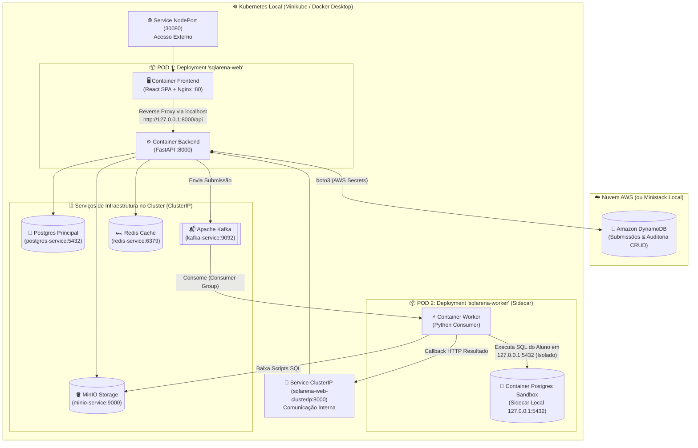

# ⚔️ SQLArena - Plataforma Distribuída de Ensino e Avaliação de SQL

> **Trabalho Prático 2 — Desenvolvimento de Software para Nuvem (UFC)**  
> **Professores:** Dr. Paulo A. L. Rego e Dr. Fernando Antonio Mota Trinta  
> **Objetivo:** Implantação da aplicação desenvolvida no Trabalho 1 utilizando **Docker**, **Docker Compose** e **Kubernetes**.

---

## 🏛️ 1. Arquitetura da Aplicação e Substituições de Serviços

Neste Trabalho Prático 2, todos os serviços que antes eram gerenciados pela AWS (RDS, S3, SQS e ElastiCache) foram **migrados para containers gerenciados localmente**, mantendo apenas o **Amazon DynamoDB** como banco NoSQL na nuvem (conforme a especificação do trabalho):

| Serviço / Camada | Tecnologia Atual | O que substitui | Função na Aplicação |
| :--- | :--- | :--- | :--- |
| **Banco NoSQL (AWS)** | **Amazon DynamoDB** | *Mantido na AWS* | Persiste de forma imutável o histórico de submissões (`sqlarena-submissions-log`) e a auditoria de ações de CRUD (`sqlarena-crud-actions-log`). |
| **Banco Relacional Principal** | **PostgreSQL 16** (`postgres:16-alpine`) | Amazon RDS | Container gerenciado pela equipe com volume persistente. Armazena usuários, categorias N:N, questões e pontuação (+10 XP). |
| **Armazenamento de Arquivos** | **MinIO** (`elestio/minio:latest`) | Amazon S3 | Container compatível com API S3 (`boto3`). Armazena scripts SQL puros de cada questão (`schema.sql`, `data.sql`, `answer.sql`) e avatares. |
| **Fila de Mensagens Assíncrona**| **Apache Kafka** (`apache/kafka:3.8.0`) | Amazon SQS | Broker em modo **KRaft** (sem Zookeeper). Tópico particionado (`sqlarena-submissions-queue`) com Consumer Group e Dead Letter Queue (DLQ). |
| **Cache & Rate Limit** | **Redis 7** (`redis:7-alpine`) | Amazon ElastiCache | Rate Limit de 5 segundos por aluno, cache de ranking e status em tempo real. |
| **Backend & Worker** | **`app/Dockerfile`** | Golden AMIs | Imagem Python 3.11 com FastAPI (API REST + seed automático `--if-empty`) e o Worker de avaliação. |
| **Frontend** | **`frontend/Dockerfile`** | Golden AMIs | Build Multi-Stage (Node 20 -> Nginx 1.27 Alpine) servindo React 19 SPA com Reverse Proxy para `/api`. |

---

## 🧩 2. Arquitetura de Pods Multi-Container no Kubernetes (Bônus de 1 Ponto)

A topologia de execução co-localiza serviços complementares dentro do mesmo Pod:



1. **POD 1 — `sqlarena-web` (`k8s/07-web-pod.yaml`):**
   * Co-localiza o **Frontend (Nginx)** e o **Backend (FastAPI)** no mesmo Pod.
   * O Nginx atende na porta `80` e despacha chamadas `/api/*` para `http://127.0.0.1:8000` via loopback interno no Pod.
   * Exposto externamente via Service **NodePort** na porta `30080` e internamente via Service **ClusterIP**.
2. **POD 2 — `sqlarena-worker` (`k8s/08-worker-pod.yaml`):**
   * Padrão **Sidecar**: co-localiza o **Worker Python** e o **PostgreSQL 16 Sandbox** (`127.0.0.1:5432`) no mesmo Pod.
   * Ao escalar via **HPA** (`k8s/09-hpa.yaml`), cada réplica do Worker nasce com seu próprio banco PostgreSQL de testes isolado.

---

## 📂 3. Estrutura de Arquivos do Projeto

```text
SQLArena/
├── app/
│   ├── Dockerfile              # Imagem unificada do Backend (FastAPI) e Worker
│   ├── entrypoint.sh           # Script de inicialização, health-wait e seed automático (--if-empty)
│   ├── api/                    # Endpoints REST (auth, questions, submissions, audit, users, ranking)
│   ├── cache/                  # Cliente Redis (Rate Limit de 5s e cache)
│   ├── database/               # PostgreSQL Principal (models SQLAlchemy, seed.py, validator.py)
│   ├── dynamodb/               # Cliente oficial do Amazon DynamoDB (AWS)
│   ├── kafka/                  # Gerenciador do Apache Kafka (substituindo SQS)
│   ├── minio/                  # Gerenciador do MinIO S3-Compatible (substituindo S3)
│   ├── worker/                 # Motor de avaliação em Sandbox PostgreSQL
│   ├── config.py               # Variáveis e configurações Pydantic
│   └── main.py                 # Ponto de entrada FastAPI
├── frontend/
│   ├── Dockerfile              # Imagem Multi-Stage (Node 20 Build -> Nginx 1.27 Alpine)
│   ├── nginx.conf.template     # Template Nginx com proxy dinâmico para /api
│   └── src/                    # SPA React 19, Tailwind CSS v4 e Monaco Editor
├── k8s/                        # Manifestos Kubernetes Locais (Bônus de 1 ponto)
│   ├── 01-configmap.yaml       # Variáveis de ambiente não-sensíveis
│   ├── 02-secrets.yaml         # Secrets (senhas Postgres, MinIO e chaves AWS DynamoDB)
│   ├── 03-postgres-main.yaml   # Deployment + PVC + Service ClusterIP do Postgres Principal
│   ├── 04-redis.yaml           # Deployment + Service ClusterIP do Redis
│   ├── 05-minio.yaml           # Deployment + PVC + Service ClusterIP e NodePort (30901) do MinIO
│   ├── 06-kafka.yaml           # Deployment + Service ClusterIP do Apache Kafka (KRaft)
│   ├── 07-web-pod.yaml         # POD 1 (Frontend + Backend) + Services NodePort (30080) e ClusterIP
│   ├── 08-worker-pod.yaml      # POD 2 (Worker + Postgres Sandbox Sidecar) + Service ClusterIP
│   └── 09-hpa.yaml             # HorizontalPodAutoscaler (HPA) para escalabilidade dos Pods
├── terraform/                  # Infraestrutura como Código exclusiva para o DynamoDB
│   ├── modules/dynamodb/       # Módulo com as tabelas de submissões e auditoria CRUD
│   ├── envs/local.tfvars       # Variáveis para Ministack local (porta 4566)
│   ├── envs/credentials.tfvars.example # Modelo para AWS Academy
│   ├── main.tf                 # Criação das tabelas DynamoDB
│   ├── variables.tf            # Declaração de variáveis
│   ├── outputs.tf              # Nomes e ARNs das tabelas
│   └── providers.tf            # Provedor AWS
├── ministack/                  # Emulador local de serviços AWS (para teste offline do DynamoDB)
│   └── docker-compose.yml      # Ministack na porta 4566
├── docker-compose.yml          # Orquestração principal de TODOS os 8 containers da aplicação
└── .env.example                # Modelo de variáveis de ambiente
```

---

## 🐳 4. GUIA DE EXECUÇÃO COM DOCKER COMPOSE (Pontuação Principal — 9,0 Pontos)

O arquivo [`docker-compose.yml`](docker-compose.yml) sobe todos os serviços com um único comando:
- `sqlarena-postgres`: PostgreSQL 16 Principal (porta `15432`)
- `sqlarena-postgres-sandbox`: PostgreSQL 16 Sandbox isolado (porta `15433`)
- `sqlarena-redis`: Redis 7 (porta `16379`)
- `sqlarena-minio`: MinIO (API S3 na porta `9000`, Console Web na porta `9001`)
- `sqlarena-kafka`: Apache Kafka 3.8 em modo KRaft (porta `9092`)
- `sqlarena-backend`: API FastAPI na porta `8000` (com seed automático de 21 questões)
- `sqlarena-worker`: Consumidor de submissões assíncronas do Kafka
- `sqlarena-frontend`: React SPA servida via Nginx na porta `80` (e `5173`)

### Passo 1: Configurar Variáveis de Ambiente (`.env`)

Copie o arquivo de exemplo na raiz:

```powershell
# Windows (PowerShell):
Copy-Item .env.example .env

# Linux / macOS:
cp .env.example .env
```

Abra o arquivo `.env` e configure o acesso ao **Amazon DynamoDB**:

#### Opção A — Usando o DynamoDB real da AWS (Recomendado):
Cole suas credenciais ativas do AWS Academy Learner Lab:
```env
AWS_REGION=us-east-1
AWS_ACCESS_KEY_ID=ASIA...
AWS_SECRET_ACCESS_KEY=...
AWS_SESSION_TOKEN=IQoJb3JpZ2luX2VjE...
DYNAMODB_ENDPOINT_URL=
```

#### Opção B — 100% Offline (Sem conta da AWS, usando Ministack):
Inicie o Ministack em outro terminal:
```powershell
docker compose -f ministack/docker-compose.yml up -d
```
E no `.env` defina:
```env
AWS_REGION=us-east-1
AWS_ACCESS_KEY_ID=test
AWS_SECRET_ACCESS_KEY=test
AWS_SESSION_TOKEN=
DYNAMODB_ENDPOINT_URL=http://host.docker.internal:4566
```

---

### Passo 2: Iniciar Toda a Aplicação com 1 Comando

Na raiz do projeto (`SQLArena/`), execute:

```powershell
docker compose up -d --build
```

O comando irá:
1. Baixar as imagens oficiais do PostgreSQL, Redis, MinIO e Kafka.
2. Construir as imagens `sqlarena-backend` e `sqlarena-frontend`.
3. Executar o `seed.py --if-empty`, populando automaticamente o PostgreSQL com os usuários e categorias, criando o bucket e os scripts `.sql` das 21 questões no MinIO, criando os tópicos no Kafka e verificando as tabelas no DynamoDB.
4. Deixar todos os containers saudáveis (*healthy*).

---

### Passo 3: Acessar a Aplicação

* 🚀 **Plataforma Web (Frontend React + API):** [http://localhost](http://localhost) (ou [http://localhost:5173](http://localhost:5173))
* 📖 **Documentação Interativa Swagger (FastAPI):** [http://localhost:8000/docs](http://localhost:8000/docs)
* 🪣 **Console Web do MinIO (S3):** [http://localhost:9001](http://localhost:9001)
  * **Usuário:** `minioadmin` | **Senha:** `minioadmin123`

---

### Passo 4: Credenciais Prontas para Teste

| Perfil | Email | Senha | Funcionalidades |
| :--- | :--- | :--- | :--- |
| **Aluno** | `gustavo@sqlarena.com` | `123456` | Resolver questões no editor Monaco, enviar consultas SQL, ver feedback instantâneo e ranking. |
| **Instrutor** | `admin@sqlarena.com` | `123456` | Criar questões com validação automática, publicar/deletar exercícios e ver logs de auditoria. |

---

### Passo 5: Comandos Úteis e Evidências de Funcionamento

```powershell
# 1. Ver o status de todos os 8 containers:
docker compose ps

# 2. Acompanhar os logs do Backend e Worker em tempo real:
docker compose logs -f backend worker

# 3. Testar a saúde da API via curl:
curl http://localhost/api/health

# 4. Executar os testes automatizados da aplicação dentro do container:
docker exec sqlarena-backend pytest app/testes/ -v

# 5. Parar todos os containers mantendo os dados salvos:
docker compose down

# 6. Parar e apagar os volumes locais (reset completo):
docker compose down -v
```

---

## ☸️ 5. GUIA DE EXECUÇÃO NO KUBERNETES LOCAL (Pontuação Extra — 1,0 Ponto)

Os manifestos da pasta [`k8s/`](k8s/) foram desenvolvidos para rodar tanto no **Minikube** quanto no **Kubernetes do Docker Desktop** ou **Kind**:

### Passo 1: Iniciar o Cluster Local

Se estiver usando o Docker Desktop no Windows/macOS:
- Abra as Configurações do Docker Desktop -> **Kubernetes** -> Marque **Enable Kubernetes** -> **Apply & restart**.

Ou se estiver usando o Minikube:
```powershell
minikube start --driver=docker
```

### Passo 2: Configurar Credenciais Seguras no Secret (`k8s/02-secrets.yaml`)

Abra o arquivo [`k8s/02-secrets.yaml`](k8s/02-secrets.yaml) e insira suas credenciais da AWS para o DynamoDB (ou deixe os valores padrão se estiver usando endpoint local).

### Passo 3: Aplicar Todos os Manifestos

```powershell
kubectl apply -f k8s/
```

### Passo 4: Verificar Pods e Services

```powershell
# Verifique se todos os Pods estão 'Running' (note READY 2/2 nos Pods Web e Worker!):
kubectl get pods

# Verifique os Services com NodePort e ClusterIP:
kubectl get services

# Verifique o auto-scaling dos Pods (HPA):
kubectl get hpa
```

### Passo 5: Acessar a Aplicação no Kubernetes

* **No Docker Desktop:**
  * 🚀 **Plataforma Web (NodePort):** [http://localhost:30080](http://localhost:30080)
  * 📖 **API Docs (NodePort):** [http://localhost:30800/docs](http://localhost:30800/docs)
  * 🪣 **MinIO Console (NodePort):** [http://localhost:30901](http://localhost:30901)
* **No Minikube:**
  Execute `minikube service sqlarena-web-nodeport` para abrir diretamente no navegador.

---

## 🏗️ 6. TERRAFORM PARA O AMAZON DYNAMODB (AWS)

Como todos os outros serviços foram conteinerizados localmente, o Terraform é utilizado estritamente para gerenciar as tabelas do **Amazon DynamoDB**:

```powershell
cd terraform

# 1. Inicializar
terraform init

# 2. Se for criar na AWS real (com credentials.tfvars):
terraform apply -var-file="envs/credentials.tfvars"

# 3. Se for criar no Ministack local:
terraform apply -var-file="envs/local.tfvars"

# 4. Para destruir as tabelas ao término da avaliação:
terraform destroy -var-file="envs/credentials.tfvars" -auto-approve
```
