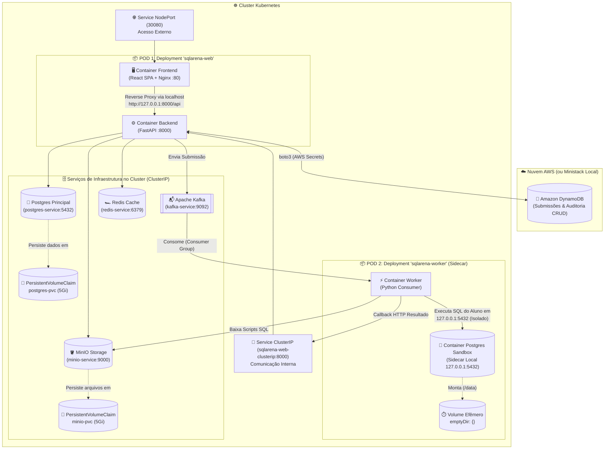

# ⚔️ SQLArena - Plataforma Distribuída de Ensino e Avaliação de SQL

Plataforma distribuída para aprendizado e avaliação automatizada de consultas SQL, com execução assíncrona orientada a eventos, isolamento em sandbox relacional, cache em memória e persistência distribuída.

---

## 🏛️ 1. Arquitetura da Aplicação

A arquitetura do SQLArena é composta por microsserviços e serviços de dados conteinerizados:

| Componente / Camada | Tecnologia | Função na Aplicação |
| :--- | :--- | :--- |
| **Banco NoSQL** | **Amazon DynamoDB** (AWS ou Ministack) | Persistência imutável do histórico de submissões (`sqlarena-submissions-log`) e auditoria de ações administrativas (`sqlarena-crud-actions-log`). |
| **Banco Relacional Principal** | **PostgreSQL 16** (`postgres:16-alpine`) | Persistência relacional de usuários, catálogo de categorias N:N, questões e pontuações consolidadas. |
| **Armazenamento de Objetos** | **MinIO** (`elestio/minio:latest`) | Armazenamento S3-compatible de scripts SQL de cada exercício (`schema.sql`, `data.sql`, `answer.sql`) e avatares de usuários. |
| **Mensageria Assíncrona** | **Apache Kafka** (`apache/kafka:3.8.0`) | Broker em modo KRaft com tópicos particionados (`sqlarena-submissions-queue`), Consumer Groups e Dead Letter Queue (DLQ). |
| **Cache & Rate Limit** | **Redis 7** (`redis:7-alpine`) | Controle de taxa de submissão (5s por usuário), cache de ranking global e estado de processamento em tempo real. |
| **Backend API** | **`app/Dockerfile`** (Python 3.11 / FastAPI) | API RESTful com autenticação JWT, validação de regras de negócio, health check real e seed automático. |
| **Worker de Avaliação** | **`app/worker/Dockerfile`** (Python 3.11) | Motor de execução em background consumidor do Kafka para execução e validação de queries SQL em sandbox. |
| **Frontend Web** | **`frontend/Dockerfile`** (React 19 / Nginx) | SPA em React 19 com Monaco Editor, Tailwind CSS e Nginx atuando como reverse proxy para a API. |

---

## 📂 2. Estrutura de Diretórios do Projeto

```text
SQLArena/
├── app/
│   ├── Dockerfile              # Dockerfile do Backend (FastAPI API REST)
│   ├── entrypoint.sh           # Script de inicialização (health-wait, seed automático e exec)
│   ├── api/                    # Endpoints REST (auth, questions, submissions, audit, users, ranking)
│   ├── cache/                  # Cliente Redis (Rate Limit de 5s e cache de ranking)
│   ├── database/               # PostgreSQL Principal (models SQLAlchemy, seed.py idempotente)
│   ├── dynamodb/               # Cliente oficial do Amazon DynamoDB (AWS Boto3)
│   ├── kafka/                  # Gerenciador do Apache Kafka (com commits e retries resilientes)
│   ├── minio/                  # Gerenciador do MinIO S3-Compatible
│   ├── worker/                 # Motor de avaliação em Sandbox PostgreSQL
│   │   ├── Dockerfile          # Dockerfile do Worker (Consumidor Kafka + Sandbox PG)
│   │   ├── main.py             # Loop consumidor do Worker
│   │   └── executor.py         # Execução e comparação estrita de consultas SQL
│   ├── config.py               # Variáveis e configurações Pydantic
│   └── main.py                 # Ponto de entrada FastAPI com health check real
├── data/                       # Diretório local unificado de dados persistidos (no .gitignore)
│   ├── postgres/               # Dados do PostgreSQL Principal
│   ├── postgres-sandbox/       # Dados do PostgreSQL Sandbox do Worker
│   ├── redis/                  # Dados persistidos do Redis
│   ├── minio/                  # Arquivos e scripts SQL salvos no MinIO
│   └── kafka/                  # Logs e partições do Apache Kafka
├── frontend/
│   ├── Dockerfile              # Dockerfile do Frontend (React 19 Build -> Nginx 1.27 Alpine)
│   ├── nginx.conf.template     # Template Nginx com proxy dinâmico para /api
│   └── src/                    # SPA React 19, Tailwind CSS v4 e Monaco Editor
├── k8s/                        # Manifestos Kubernetes Locais (100% agnósticos)
│   ├── 01-configmap.yaml       # Configurações não-sensíveis dos serviços do cluster
│   ├── 03-postgres.yaml        # Deployment + PVC + Service ClusterIP do Postgres Principal
│   ├── 04-redis.yaml           # Deployment + Service ClusterIP do Redis
│   ├── 05-minio.yaml           # Deployment + PVC + Service ClusterIP e NodePort (30901) do MinIO
│   ├── 06-kafka.yaml           # Deployment + Service ClusterIP do Apache Kafka (KRaft)
│   ├── 07-web.yaml             # POD 1 (Frontend + Backend) + Services NodePort (30080) e ClusterIP
│   ├── 08-worker.yaml          # POD 2 (Worker + Postgres Sandbox Sidecar) + Service ClusterIP
│   ├── 09-hpa.yaml             # HorizontalPodAutoscaler (HPA) para escalabilidade dos Pods
│   └── README.md               # Guia didático completo sobre Pods, Deployments e Services (ClusterIP vs NodePort)
├── terraform/                  # Infraestrutura como Código para o DynamoDB
│   ├── modules/dynamodb/       # Módulo com as tabelas de submissões e auditoria CRUD
│   ├── envs/credentials.tfvars.example # Modelo para credenciais da AWS
│   ├── envs/local.tfvars       # Variáveis para Ministack local (porta 4566)
│   ├── main.tf                 # Definição dos recursos DynamoDB
│   ├── variables.tf            # Declaração de variáveis
│   ├── outputs.tf              # Nomes e ARNs das tabelas
│   └── providers.tf            # Provedor AWS
├── ministack/                  # Emulador local de serviços AWS (para execução offline do DynamoDB)
│   └── docker-compose.yml      # Ministack na porta 4566
├── docker-compose.yml          # Orquestração de TODOS os containers com volumes mapeados em ./data/
└── .env.example                # Único modelo de variáveis de ambiente do projeto
```

---

## 📋 GUIA DE EXECUÇÃO SEQUENCIAL

Siga rigorosamente os passos abaixo para configurar e executar o projeto.

---

### PASSO 1: Configurar a Camada NoSQL (Amazon DynamoDB)

A primeira etapa consiste em definir se a aplicação utilizará o **Amazon DynamoDB na nuvem da AWS** ou o **emulador local offline (Ministack)**.

Primeiro, crie o arquivo `.env` na raiz do projeto copiando o modelo de exemplo:

* **No macOS / Linux:**
  ```bash
  cp .env.example .env
  ```
* **No Windows (PowerShell):**
  ```powershell
  Copy-Item .env.example .env
  ```

Agora, escolha **uma** das duas opções a seguir para o DynamoDB:

---

#### 🟢 OPÇÃO 1.A: Utilizar o Amazon DynamoDB Oficial na AWS

1. **Provisionar as tabelas no DynamoDB via Terraform:**
   * Acesse o diretório de variáveis do Terraform e copie o modelo:
     * No macOS / Linux:
       ```bash
       cd terraform/envs && cp credentials.tfvars.example credentials.tfvars
       ```
     * No Windows (PowerShell):
       ```powershell
       cd terraform\envs; Copy-Item credentials.tfvars.example credentials.tfvars
       ```
   * Abra o arquivo `credentials.tfvars` e insira suas credenciais ativas da AWS (`aws_access_key`, `aws_secret_key` e `aws_session_token`).
   * Retorne à pasta `terraform`:
     ```bash
     cd ..
     ```
   * Inicialize os plugins do Terraform:
     ```bash
     terraform init
     ```
   * Aplique a criação das tabelas na AWS:
     ```bash
     terraform apply -var-file="envs/credentials.tfvars" -auto-approve
     ```
   * Retorne à raiz do projeto:
     ```bash
     cd ..
     ```
     *(As tabelas `sqlarena-submissions-log` e `sqlarena-crud-actions-log` serão criadas na AWS).*

2. **Preencher o arquivo `.env` na raiz do projeto:**
   Abra o `.env` e configure suas credenciais da AWS:
   ```env
   AWS_REGION=us-east-1
   AWS_ACCESS_KEY_ID=ASIA...
   AWS_SECRET_ACCESS_KEY=...
   AWS_SESSION_TOKEN=IQoJb3JpZ2luX2VjE...
   DYNAMODB_ENDPOINT_URL=
   ```
   *(Mantenha `DYNAMODB_ENDPOINT_URL=` vazio para conectar diretamente aos servidores da AWS).*

---

#### 🟡 OPÇÃO 1.B: Execução 100% Offline (Sem AWS, via Ministack)

1. **Configurar o arquivo `.env` na raiz primeiro:**
   Abra o arquivo `.env` e ajuste as variáveis para apontar para o container do Ministack local:
   ```env
   AWS_REGION=us-east-1
   AWS_ACCESS_KEY_ID=test
   AWS_SECRET_ACCESS_KEY=test
   AWS_SESSION_TOKEN=
   DYNAMODB_ENDPOINT_URL=http://host.docker.internal:4566
   ```

2. **Iniciar o container do Ministack:**
   Execute no terminal para inicializar o emulador local na porta `4566`:
   ```bash
   docker compose -f ministack/docker-compose.yml up -d
   ```

*(Nota: O backend da aplicação detecta o Ministack e inicializa as tabelas automaticamente no primeiro boot).*

---

### PASSO 2: Escolha a Plataforma de Execução

Com o DynamoDB configurado no **Passo 1**, escolha o método de execução da aplicação:

* **[Caminho A: Docker Compose](#-caminho-a-executar-via-docker-compose)** (Execução unificada de todos os containers)
* **[Caminho B: Kubernetes](#-caminho-b-executar-via-kubernetes)** (Orquestração via Pods Multi-Container, Services e HPA)

---

### 🐳 CAMINHO A: Executar via Docker Compose

O arquivo [`docker-compose.yml`](docker-compose.yml) orquestra de forma integrada todos os 8 containers com **3 Dockerfiles dedicados** e armazenamento persistente mapeado diretamente no diretório local `./data/`:

* **Imagens criadas via Dockerfile:**
  * `sqlarena-backend:latest` (`app/Dockerfile`) — API FastAPI na porta `8000` (com seed automático seguro `--if-empty`).
  * `sqlarena-worker:latest` (`app/worker/Dockerfile`) — Consumidor assíncrono do Kafka e motor de avaliação.
  * `sqlarena-frontend:latest` (`frontend/Dockerfile`) — React SPA servida via Nginx na porta `80` (e `5173`).
* **Serviços de dados (com volumes mapeados no diretório local `./data/`):**
  * `sqlarena-postgres`: PostgreSQL 16 Principal (porta `15432`) -> `./data/postgres`
  * `sqlarena-postgres-sandbox`: PostgreSQL 16 Sandbox isolado (porta `15433`) -> `./data/postgres-sandbox`
  * `sqlarena-redis`: Redis 7 (porta `16379`) -> `./data/redis`
  * `sqlarena-minio`: MinIO Object Storage (porta `9000` / Console `9001`) -> `./data/minio`
  * `sqlarena-kafka`: Apache Kafka 3.8 em modo KRaft (porta `9092`) -> `./data/kafka`

> 💡 **Vantagem da pasta `./data/`:** Todos os dados persistidos ficam visíveis no seu explorador de arquivos em uma única pasta ignorada pelo Git. Você não precisa inspecionar volumes internos do Docker.

#### 1. Iniciar toda a aplicação com 1 comando:
Na raiz do projeto (`SQLArena/`), execute:
```bash
docker compose up -d --build
```

O comando irá construir as 3 imagens locais via Dockerfile, aguardar os health checks das dependências e iniciar a API, o Worker e o Frontend.

#### 2. Verificar o status dos containers:
```bash
docker compose ps
```
Todos os containers devem exibir o status **`Up (healthy)`** ou **`Up`**.

#### 3. Para pausar ou resetar a aplicação:
* **Pausar mantendo os dados salvos em `./data/`:**
  ```bash
  docker compose down
  ```
* **Resetar completamente (apagar containers, redes e a pasta de dados `./data/`):**
  * No macOS / Linux:
    ```bash
    docker compose down -v
    ```
    ```bash
    rm -rf data
    ```
  * No Windows (PowerShell):
    ```powershell
    docker compose down -v
    ```
    ```powershell
    Remove-Item -Recurse -Force data
    ```

---

### ☸️ CAMINHO B: Executar via Kubernetes

A aplicação disponibiliza manifestos 100% compatíveis com qualquer cluster Kubernetes local (**OrbStack**, **Docker Desktop**, **K3s**, etc.) utilizando topologia de Pods Multi-Container:



* **POD 1 — `sqlarena-web` (`k8s/07-web.yaml`):** Co-localiza o **Frontend** e o **Backend** no mesmo Pod. O Nginx atende na porta `80` e repassa requisições `/api` via loopback interno (`http://127.0.0.1:8000`). Exposto externamente via Service **NodePort** (`30080`) e internamente via Service **ClusterIP**.
* **POD 2 — `sqlarena-worker` (`k8s/08-worker.yaml`):** Padrão **Sidecar** co-localizando o **Worker Python** e o **PostgreSQL Sandbox** isolado (`127.0.0.1:5432`). Ao escalar via HPA, cada réplica ganha seu próprio sandbox independente.

> 📖 **Quer entender a fundo como funciona Pods, Deployments e Services (ClusterIP vs NodePort)?** Consulte nosso guia didático em [k8s/README.md](k8s/README.md).

#### 1. Aplicar a aplicação com `kubectl` (Leitura direta do `.env`):

Você **não precisa editar nenhum arquivo YAML do Kubernetes**. O Kubernetes lê diretamente o arquivo `.env` configurado no **Passo 1**:

* **Passo A:** Carregar todos os segredos do `.env` automaticamente no cluster:
  ```bash
  kubectl create secret generic sqlarena-secrets --from-env-file=.env --dry-run=client -o yaml | kubectl apply -f -
  ```

* **Passo B:** Inicializar todos os serviços, Pods e autoscaling (HPA):
  ```bash
  kubectl apply -f k8s/
  ```

#### 2. Verificar Pods e Services:
* Verifique se todos os Pods estão 'Running' (observe READY 2/2 nos Pods Web e Worker):
  ```bash
  kubectl get pods
  ```

* Listar os Services (NodePort e ClusterIP):
  ```bash
  kubectl get services
  ```

* Inspecionar o auto-scaling dos Pods (HPA):
  ```bash
  kubectl get hpa
  ```

#### 3. Para encerrar o Kubernetes:
* Remover os recursos do cluster:
  ```bash
  kubectl delete -f k8s/
  ```

* Remover o secret gerado:
  ```bash
  kubectl delete secret sqlarena-secrets
  ```

---

### PASSO 3: Acessar a Aplicação no Navegador

Após a inicialização (seja por **Docker Compose** ou **Kubernetes**), acesse os serviços:

| Serviço | URL via Docker Compose | URL via Kubernetes (NodePort) | Credenciais de Acesso |
| :--- | :--- | :--- | :--- |
| **Plataforma Web (Frontend)** | [http://localhost](http://localhost) (ou `:5173`) | [http://localhost:30080](http://localhost:30080) | *(Ver Passo 4)* |
| **Documentação da API (Swagger)** | [http://localhost:8000/docs](http://localhost:8000/docs) | [http://localhost:30800/docs](http://localhost:30800/docs) | Acesso livre |
| **Console Web do MinIO Storage** | [http://localhost:9001](http://localhost:9001) | [http://localhost:30901](http://localhost:30901) | **Usuário:** `minioadmin`<br>**Senha:** `minioadmin123` |

---

### PASSO 4: Credenciais Pré-configuradas para Teste

O seed da aplicação cadastra automaticamente dois perfis para validação do sistema:

| Papel | Email | Senha | Operações Disponíveis |
| :--- | :--- | :--- | :--- |
| **Aluno** | `aluno@sqlarena.com` | `123456` | Acessar catálogo com 21 exercícios de SQL, redigir consultas no editor interativo Monaco, submeter queries para avaliação assíncrona, receber diagnóstico em tempo real e visualizar ranking geral. |
| **Instrutor** | `admin@sqlarena.com` | `123456` | Criar novas questões com validação automática de scripts SQL (DDL, DML e gabarito), gerenciar status de publicação/exclusão e consultar logs de auditoria no DynamoDB. |

---

### PASSO 5: Teste de Carga e Auto-scaling dos Pods (Locust)

O projeto inclui um cenário automatizado de teste de estresse em `locust/locustfile.py` que simula alunos simultâneos resolvendo exercícios e submetendo queries para a fila do Kafka, permitindo validar na prática o **HorizontalPodAutoscaler (HPA)** do Kubernetes escalando os Pods de Worker.

#### 1. Monitorar a escala dos Pods em tempo real (Terminal 1):

Abra um terminal e execute o comando de monitoramento contínuo:

* Monitorar o status do HPA (CPU e réplicas atuais/desejadas):
  ```bash
  kubectl get hpa -w
  ```

* Ou monitorar a criação física dos novos Pods de Worker:
  ```bash
  kubectl get pods -l tier=worker -w
  ```

#### 2. Disparar a carga com Locust (Terminal 2):

Em outro terminal na raiz do projeto:

* Instalar o Locust (caso ainda não possua):
  ```bash
  pip install locust
  ```

* **Opção A — Modo Visual (Navegador):**
  ```bash
  locust -f locust/locustfile.py --host http://localhost:30800
  ```
  > Abra **[http://localhost:8089](http://localhost:8089)** no navegador, informe **30 usuários** com spawn rate de **5** e clique em **Start Swarming**.

* **Opção B — Modo Headless (Execução direta no terminal por 1 minuto):**
  ```bash
  locust -f locust/locustfile.py --host http://localhost:30800 --users 30 --spawn-rate 5 --run-time 1m --headless
  ```

> 🎯 **Resultado Esperado:** Conforme as queries são enfileiradas e a CPU dos workers ultrapassa o limiar estipulado (`60%`), o Kubernetes escalará automaticamente o Deployment `sqlarena-worker` de **1 para até 4 réplicas simultâneas**, cada uma com sua respectiva Sandbox descartável. Ao término da carga, o HPA reduzirá gradualmente as réplicas de volta para 1.

---

### PASSO 6: Limpeza e Finalização (Tear Down)

Ao encerrar os testes:

1. **Se utilizou a AWS Real (Terraform):**
   Para evitar custos na sua conta AWS, destrua as tabelas do DynamoDB:
   * Acesse a pasta terraform:
     ```bash
     cd terraform
     ```
   * Destrua as tabelas:
     ```bash
     terraform destroy -var-file="envs/credentials.tfvars" -auto-approve
     ```
   * Retorne à raiz:
     ```bash
     cd ..
     ```
2. **Se utilizou o Docker Compose:**
   ```bash
   docker compose down -v
   ```
3. **Se utilizou o Ministack local:**
   ```bash
   docker compose -f ministack/docker-compose.yml down -v
   ```
4. **Se utilizou o Kubernetes:**
   * Remova os recursos do cluster:
     ```bash
     kubectl delete -f k8s/
     ```
   * Remova o secret:
     ```bash
     kubectl delete secret sqlarena-secrets
     ```

---

## 💻 Apêndice: Como Habilitar o Kubernetes no seu Sistema Operacional

Os manifestos da pasta `k8s/` utilizam exclusivamente a ferramenta padrão **`kubectl`** e funcionam em qualquer sistema:

### 🍎 macOS (com OrbStack ou Docker Desktop)
* **OrbStack (Mais leve e rápido — Recomendado):**
  1. Abra o OrbStack.
  2. Vá em **Settings / Preferences** (ícone de engrenagem) -> aba **Kubernetes**.
  3. Marque **Enable Kubernetes**.
  4. Pronto! O `kubectl` já estará configurado e as portas NodePort abrem nativamente no `localhost:30080`.
* **Docker Desktop no Mac:**
  Abra Settings -> **Kubernetes** -> Marque **Enable Kubernetes** -> **Apply & restart**.

### 🪟 Windows (com Docker Desktop)
1. Abra o Docker Desktop.
2. Clique no ícone de engrenagem (Settings) no canto superior direito.
3. Acesse a aba **Kubernetes**.
4. Marque a caixa **Enable Kubernetes** e clique em **Apply & restart**.
5. Aguarde o indicador do Kubernetes no rodapé do Docker Desktop ficar verde.

### 🐧 Linux (com K3s ou Docker Desktop)
* **Opção K3s (Super leve):**
  * Instalar o K3s:
    ```bash
    curl -sfL https://get.k3s.io | sh -
    ```
  * Exportar o kubeconfig:
    ```bash
    export KUBECONFIG=/etc/rancher/k3s/k3s.yaml
    ```
* **Opção Docker Desktop for Linux:**
  Mesmo procedimento do Windows (Settings -> Kubernetes -> Enable).
