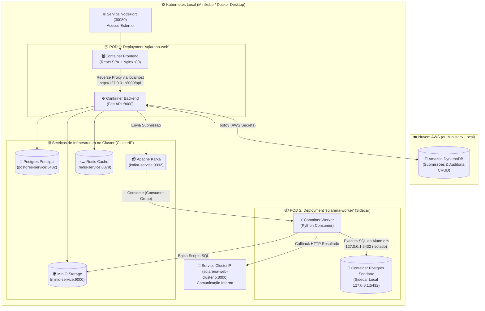

# ⚔️ SQLArena - Plataforma Distribuída de Ensino e Avaliação de SQL

> **Trabalho Prático 2 — Desenvolvimento de Software para Nuvem (UFC)**  
> **Professores:** Dr. Paulo A. L. Rego e Dr. Fernando Antonio Mota Trinta  
> **Objetivo:** Implantação da aplicação desenvolvida no Trabalho 1 utilizando **Docker**, **Docker Compose** e **Kubernetes**.

---

## 🏛️ 1. Arquitetura da Aplicação e Substituições de Serviços

Neste Trabalho Prático 2, todos os serviços que antes eram gerenciados pela AWS (RDS, S3, SQS e ElastiCache) foram **migrados para containers gerenciados localmente**, mantendo apenas o **Amazon DynamoDB** como banco NoSQL na nuvem (conforme a especificação do trabalho):

| Serviço / Camada | Tecnologia Atual | O que substitui | Função na Aplicação |
| :--- | :--- | :--- | :--- |
| **Banco NoSQL (AWS)** | **Amazon DynamoDB** | *Mantido na AWS* | Persiste de forma imutável o histórico de submissões (`sqlarena-submissions-log`) e a auditoria de ações de CRUD (`sqlarena-crud-actions-log`). |
| **Banco Relacional Principal** | **PostgreSQL 16** (`postgres:16-alpine`) | Amazon RDS | Container gerenciado pela equipe com volume persistente. Armazena usuários, categorias N:N, questões e pontuação (+10 XP). |
| **Armazenamento de Arquivos** | **MinIO** (`elestio/minio:latest`) | Amazon S3 | Container compatível com API S3 (`boto3`). Armazena scripts SQL puros de cada questão (`schema.sql`, `data.sql`, `answer.sql`) e avatares. |
| **Fila de Mensagens Assíncrona**| **Apache Kafka** (`apache/kafka:3.8.0`) | Amazon SQS | Broker em modo **KRaft** (sem Zookeeper). Tópico particionado (`sqlarena-submissions-queue`) com Consumer Group e Dead Letter Queue (DLQ). |
| **Cache & Rate Limit** | **Redis 7** (`redis:7-alpine`) | Amazon ElastiCache | Rate Limit de 5 segundos por aluno, cache de ranking e status em tempo real. |
| **Backend & Worker** | **`app/Dockerfile`** | Golden AMIs | Imagem Python 3.11 com FastAPI (API REST + seed automático seguro `--if-empty`) e o Worker de avaliação. |
| **Frontend** | **`frontend/Dockerfile`** | Golden AMIs | Build Multi-Stage (Node 20 -> Nginx 1.27 Alpine) servindo React 19 SPA com Reverse Proxy para `/api`. |

---

## 🛡️ 2. Melhorias Críticas de Confiabilidade e Segurança Implementadas

Com base em revisão técnica e testes de estresse, 4 melhorias fundamentais foram incorporadas ao código:

1. **Proteção Total do Progresso de Alunos no Seed (`app/database/seed.py`):**
   * O script agora roda com a flag `--if-empty` no boot do container.
   * Se o banco já tiver as 21 questões cadastradas, o seed não executa recarga desnecessária.
   * Pontuações acumuladas de alunos (`user.score`), contagem de resoluções (`user.solved_count`, `UserSolvedQuestion`) e registros de submissões no DynamoDB **nunca são apagados** em reinicializações normais. Resets completos só ocorrem se for passada a flag explícita `--reset-all`.
2. **Autenticação Obrigatória no Callback dos Workers (`app/api/submissions.py`):**
   * O endpoint interno `/api/submissions/callback` agora exige o cabeçalho `x-internal-key` correspondente à chave configurada em `INTERNAL_API_KEY`.
   * Requisições sem o cabeçalho ou com chave incorreta são rejeitadas com **HTTP 403 Forbidden**, impedindo qualquer atribuição indevida de pontuação (+10 XP).
3. **Resiliência e Recuperação de Mensagens no Kafka (`app/kafka/kafka_manager.py`):**
   * O adaptador apenas remove mensagens do rastreamento local (`_uncommitted_offsets`) **após** a confirmação bem-sucedida do commit no Kafka.
   * Em caso de falha no commit ou no envio para a Dead Letter Queue (DLQ), a mensagem permanece registrada para reprocessamento seguro.
4. **Health Check Real e Inicialização Fail-Fast (`app/main.py` & `app/entrypoint.sh`):**
   * Os endpoints `/health` e `/api/health` agora validam a conectividade real com o **PostgreSQL Principal**, o **Redis** e o **MinIO**. Se qualquer serviço falhar, a API retorna **HTTP 503 Service Unavailable**.
   * O `app/entrypoint.sh` agora interrompe o boot imediatamente (`set -e`) se a validação ou o seed do banco falhar, garantindo que o container nunca entre em rotação atendendo tráfego sem os dados estarem devidamente preparados.

---

## 🧩 3. Arquitetura de Pods Multi-Container no Kubernetes (Bônus de 1 Ponto)

A topologia de execução co-localiza serviços complementares dentro do mesmo Pod:



1. **POD 1 — `sqlarena-web` (`k8s/07-web-pod.yaml`):**
   * Co-localiza o **Frontend (Nginx)** e o **Backend (FastAPI)** no mesmo Pod.
   * O Nginx atende na porta `80` e despacha chamadas `/api/*` para `http://127.0.0.1:8000` via loopback interno no Pod.
   * Exposto externamente via Service **NodePort** na porta `30080` e internamente via Service **ClusterIP**.
2. **POD 2 — `sqlarena-worker` (`k8s/08-worker-pod.yaml`):**
   * Padrão **Sidecar**: co-localiza o **Worker Python** e o **PostgreSQL 16 Sandbox** (`127.0.0.1:5432`) no mesmo Pod.
   * Ao escalar via **HPA** (`k8s/09-hpa.yaml`), cada réplica do Worker nasce com seu próprio banco PostgreSQL de testes isolado.

---

## 📂 4. Estrutura de Arquivos do Projeto

```text
SQLArena/
├── app/
│   ├── Dockerfile              # Imagem unificada do Backend (FastAPI) e Worker
│   ├── entrypoint.sh           # Script de inicialização fail-fast e seed automático
│   ├── api/                    # Endpoints REST (auth, questions, submissions, audit, users, ranking)
│   ├── cache/                  # Cliente Redis (Rate Limit de 5s e cache)
│   ├── database/               # PostgreSQL Principal (models SQLAlchemy, seed.py com proteção de score)
│   ├── dynamodb/               # Cliente oficial do Amazon DynamoDB (AWS)
│   ├── kafka/                  # Gerenciador do Apache Kafka (com commits e retries resilientes)
│   ├── minio/                  # Gerenciador do MinIO S3-Compatible (substituindo S3)
│   ├── worker/                 # Motor de avaliação em Sandbox PostgreSQL
│   ├── config.py               # Variáveis e configurações Pydantic
│   └── main.py                 # Ponto de entrada FastAPI com health check real
├── frontend/
│   ├── Dockerfile              # Imagem Multi-Stage (Node 20 Build -> Nginx 1.27 Alpine)
│   ├── nginx.conf.template     # Template Nginx com proxy dinâmico para /api
│   └── src/                    # SPA React 19, Tailwind CSS v4 e Monaco Editor
├── k8s/                        # Manifestos Kubernetes Locais (Bônus de 1 ponto)
│   ├── 01-configmap.yaml       # Variáveis de ambiente não-sensíveis
│   ├── 02-secrets.yaml         # Secrets (senhas Postgres, MinIO e chaves AWS DynamoDB)
│   ├── 03-postgres-main.yaml   # Deployment + PVC + Service ClusterIP do Postgres Principal
│   ├── 04-redis.yaml           # Deployment + Service ClusterIP do Redis
│   ├── 05-minio.yaml           # Deployment + PVC + Service ClusterIP e NodePort (30901) do MinIO
│   ├── 06-kafka.yaml           # Deployment + Service ClusterIP do Apache Kafka (KRaft)
│   ├── 07-web-pod.yaml         # POD 1 (Frontend + Backend) + Services NodePort (30080) e ClusterIP
│   ├── 08-worker-pod.yaml      # POD 2 (Worker + Postgres Sandbox Sidecar) + Service ClusterIP
│   └── 09-hpa.yaml             # HorizontalPodAutoscaler (HPA) para escalabilidade dos Pods
├── terraform/                  # Infraestrutura como Código exclusiva para o DynamoDB
│   ├── modules/dynamodb/       # Módulo com as tabelas de submissões e auditoria CRUD
│   ├── envs/local.tfvars       # Variáveis para Ministack local (porta 4566)
│   ├── envs/credentials.tfvars.example # Modelo para AWS Academy
│   ├── main.tf                 # Criação das tabelas DynamoDB
│   ├── variables.tf            # Declaração de variáveis
│   ├── outputs.tf              # Nomes e ARNs das tabelas
│   └── providers.tf            # Provedor AWS
├── ministack/                  # Emulador local de serviços AWS (para teste offline do DynamoDB)
│   └── docker-compose.yml      # Ministack na porta 4566
├── docker-compose.yml          # Orquestração principal de TODOS os 8 containers da aplicação
└── .env.example                # Modelo de variáveis de ambiente
```

---

## 🐳 5. GUIA PASSO A PASSO PARA EXECUÇÃO COM DOCKER COMPOSE

Siga este passo a passo para executar a aplicação manualmente em sua máquina:

### Pré-requisitos
* **Docker Desktop** instalado e em execução (Windows com WSL2, Linux ou macOS).
* Terminal aberto na raiz do projeto (`C:\Users\gustavo\Desktop\SQLArena` ou diretório correspondente).

---

### Passo 1: Configurar o arquivo `.env`

Copie o arquivo de exemplo `.env.example` para `.env`:

```powershell
# No Windows PowerShell:
Copy-Item .env.example .env

# No Linux ou macOS:
cp .env.example .env
```

Abra o arquivo `.env` gerado e escolha uma das duas opções para o DynamoDB:

#### Opção A — Conectar ao Amazon DynamoDB real da AWS (Recomendado):
Cole suas credenciais temporárias ativas (do AWS Academy Learner Lab):
```env
AWS_REGION=us-east-1
AWS_ACCESS_KEY_ID=ASIA...
AWS_SECRET_ACCESS_KEY=...
AWS_SESSION_TOKEN=IQoJb3JpZ2luX2VjE...
DYNAMODB_ENDPOINT_URL=
```

#### Opção B — Execução 100% Offline (Sem conta da AWS, usando Ministack):
Se preferir rodar sem AWS, suba o Ministack em outro terminal:
```powershell
docker compose -f ministack/docker-compose.yml up -d
```
E ajuste o `.env` para:
```env
AWS_REGION=us-east-1
AWS_ACCESS_KEY_ID=test
AWS_SECRET_ACCESS_KEY=test
AWS_SESSION_TOKEN=
DYNAMODB_ENDPOINT_URL=http://host.docker.internal:4566
```

---

### Passo 2: Subir todos os serviços com o Docker Compose

Execute na raiz do projeto:

```powershell
docker compose up -d --build
```

O Docker irá:
1. Baixar as imagens base (`postgres:16-alpine`, `redis:7-alpine`, `elestio/minio:latest`, `apache/kafka:3.8.0`).
2. Fazer o build da imagem do backend (`app/Dockerfile`) e do frontend (`frontend/Dockerfile`).
3. Aguardar os health checks das dependências (Postgres, MinIO, Redis e Kafka).
4. Inicializar o container da API executando o `seed.py --if-empty` (populando questões, categorias e MinIO de forma idempotente).
5. Inicializar o Worker consumidor e o Nginx com o Frontend.

---

### Passo 3: Conferir o status dos containers

Verifique se todos os 8 containers estão ativos e saudáveis (*healthy*):

```powershell
docker compose ps
```

Saída esperada:
```text
NAME                        IMAGE                     STATUS                   PORTS
sqlarena-backend            sqlarena-backend:latest   Up (healthy)             0.0.0.0:8000->8000/tcp
sqlarena-frontend           sqlarena-frontend:latest  Up                       0.0.0.0:80->80/tcp, 0.0.0.0:5173->80/tcp
sqlarena-kafka              apache/kafka:3.8.0        Up (healthy)             0.0.0.0:9092->9092/tcp
sqlarena-minio              elestio/minio:latest      Up (healthy)             0.0.0.0:9000-9001->9000-9001/tcp
sqlarena-postgres           postgres:16-alpine        Up (healthy)             0.0.0.0:15432->5432/tcp
sqlarena-postgres-sandbox   postgres:16-alpine        Up (healthy)             0.0.0.0:15433->5432/tcp
sqlarena-redis              redis:7-alpine            Up (healthy)             0.0.0.0:16379->6379/tcp
sqlarena-worker             sqlarena-backend:latest   Up                       
```

Para inspecionar o log de inicialização do backend:
```powershell
docker compose logs backend
```

---

### Passo 4: Acessar a aplicação no navegador

Abra o seu navegador e acesse:

* 🌐 **Plataforma Web (Frontend React):** [http://localhost](http://localhost) (ou [http://localhost:5173](http://localhost:5173))
* 📖 **Documentação Swagger da API:** [http://localhost:8000/docs](http://localhost:8000/docs)
* 🪣 **Console Web do MinIO Storage:** [http://localhost:9001](http://localhost:9001)
  * **Usuário:** `minioadmin`
  * **Senha:** `minioadmin123`

---

### Passo 5: Credenciais pré-cadastradas para testar

| Papel | Email | Senha | O que você pode fazer |
| :--- | :--- | :--- | :--- |
| **Aluno** | `gustavo@sqlarena.com` | `123456` | Ver catálogo de 21 questões, escrever consultas no editor Monaco, submeter SQL para avaliação assíncrona, ver ranking e histórico. |
| **Instrutor** | `admin@sqlarena.com` | `123456` | Criar novas questões com validação automática de SQL, publicar/deletar exercícios e ver logs de auditoria no DynamoDB. |

---

### Passo 6: Executar os testes automatizados

Para verificar a integridade da aplicação diretamente no container do Backend:

```powershell
# Executar a suíte de segurança, resiliência do Kafka, saúde e proteção de scores:
docker exec sqlarena-backend pytest app/testes/test_security_and_reliability.py -v

# Executar todos os testes:
docker exec sqlarena-backend pytest app/testes/ -v
```

---

### Passo 7: Como encerrar a aplicação

* **Para pausar os containers (mantendo todos os dados salvos nos volumes):**
  ```powershell
  docker compose down
  ```
* **Para apagar tudo e resetar o ambiente completamente (containers, volumes e redes):**
  ```powershell
  docker compose down -v
  ```

---

## ☸️ 6. GUIA DE EXECUÇÃO NO KUBERNETES LOCAL (Bônus de 1 Ponto)

Os manifestos da pasta [`k8s/`](k8s/) foram desenvolvidos para rodar em clusters locais como **Minikube** ou **Kubernetes integrado do Docker Desktop**:

### Passo 1: Habilitar o Cluster Local
* **No Docker Desktop:** Abra Settings -> **Kubernetes** -> Marque **Enable Kubernetes** -> **Apply & restart**.
* **Ou no Minikube:** Execute `minikube start --driver=docker`.

### Passo 2: Configurar Credenciais Seguras no Secret
Edite [`k8s/02-secrets.yaml`](k8s/02-secrets.yaml) e configure as credenciais da AWS para o DynamoDB.

### Passo 3: Aplicar os Manifestos
```powershell
kubectl apply -f k8s/
```

### Passo 4: Conferir Pods e Services
```powershell
# Verificar se todos os Pods estão 'Running' (observe o status 2/2 nos Pods Web e Worker!):
kubectl get pods

# Listar os Services (NodePort e ClusterIP):
kubectl get services

# Inspecionar o Horizontal Pod Autoscaler:
kubectl get hpa
```

### Passo 5: Acesso aos Serviços no Kubernetes
* 🌐 **Plataforma Web:** [http://localhost:30080](http://localhost:30080)
* 📖 **API Docs:** [http://localhost:30800/docs](http://localhost:30800/docs)
* 🪣 **MinIO Console:** [http://localhost:30901](http://localhost:30901)
*(No Minikube, execute `minikube service sqlarena-web-nodeport` para abrir a porta no browser).*

---

## 🏗️ 7. TERRAFORM PARA O AMAZON DYNAMODB (AWS)

Como todos os outros serviços foram conteinerizados localmente, o Terraform gerencia exclusivamente as tabelas NoSQL no **Amazon DynamoDB**:

```powershell
cd terraform

# 1. Inicializar plugins do Terraform
terraform init

# 2. Criar as tabelas no DynamoDB da AWS:
terraform apply -var-file="envs/credentials.tfvars"

# 3. Ou criar as tabelas no Ministack local (offline):
terraform apply -var-file="envs/local.tfvars"

# 4. Destruir as tabelas ao encerrar os testes:
terraform destroy -var-file="envs/credentials.tfvars" -auto-approve
```
