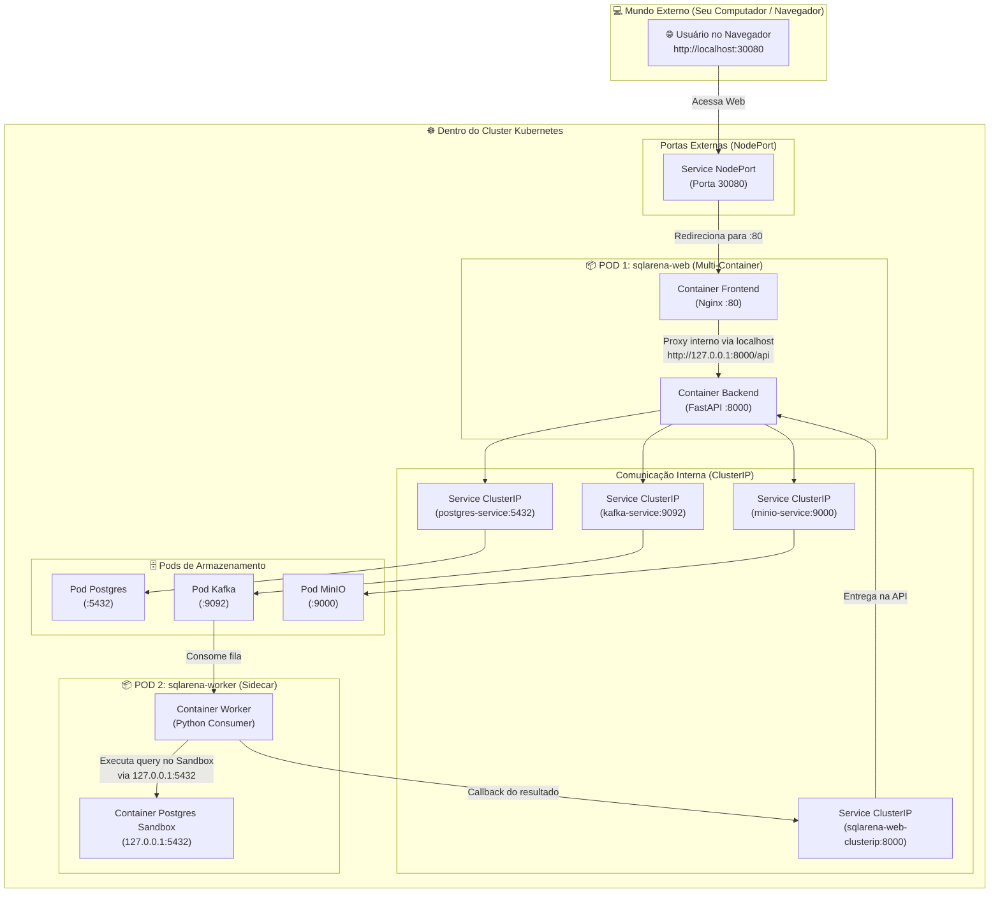

# ☸️ Guia Didático: Entendendo o Kubernetes no SQLArena

Este documento foi criado para explicar de forma simples, prática e sem termos excessivamente difíceis os principais conceitos do Kubernetes utilizados na arquitetura do **SQLArena**.

---

## 🏢 1. A Hierarquia Básica: Quem manda em quem?

No Kubernetes, existe uma hierarquia muito clara de objetos:

```text
Deployment (O Gerente)
   └── ReplicaSet (O Fiscal de Contratos)
         └── Pod (O Apartamento / Quitinete)
               └── Container(s) (Os Moradores / Processos Docker)
```

---

## 📦 2. O que é um Pod?

O **Pod** é a menor unidade que você pode criar e gerenciar no Kubernetes. 

> 💡 **Analogia da Quitinete:**  
> Pense em um Pod como uma quitinete (apartamento pequeno). Ele possui um endereço de rede próprio (um endereço IP) e um espaço em disco. Todos os containers que moram dentro desse mesmo Pod compartilham:
> 1. **A mesma rede e endereço IP:** Eles conversam entre si instantaneamente via `localhost` (ou `127.0.0.1`), sem precisar passar pela rede externa.
> 2. **O mesmo ciclo de vida:** Se o Pod for destruído, todos os seus moradores (containers) são destruídos juntos.

### Como usamos no SQLArena?

No SQLArena, dividimos os Pods em dois tipos:

1. **Pods de Container Único (1 morador):**
   * [`03-postgres.yaml`](03-postgres.yaml): Roda apenas o container do PostgreSQL Principal.
   * [`04-redis.yaml`](04-redis.yaml): Roda apenas o container do Redis Cache.
   * [`05-minio.yaml`](05-minio.yaml): Roda apenas o container do MinIO Storage.
   * [`06-kafka.yaml`](06-kafka.yaml): Roda apenas o container do Apache Kafka.

2. **Pods Especiais Multi-Container (2 moradores no mesmo Pod):**
   * [`07-web.yaml`](07-web.yaml): Co-localiza o **Frontend (Nginx/React)** e o **Backend (FastAPI)**. O Nginx atende na porta `80` e repassa chamadas `/api` diretamente para `http://127.0.0.1:8000` via loopback interno no mesmo Pod.
   * [`08-worker.yaml`](08-worker.yaml): Utiliza o padrão **Sidecar**. O **Worker Python** roda junto com um **PostgreSQL Sandbox** descartável. Quando o aluno submete uma query SQL, o Worker executa o teste direto no `127.0.0.1:5432` local daquele Pod. Ao escalar com o HPA (`09-hpa.yaml`), cada réplica nasce com seu próprio banco de testes isolado!

---

## 👨‍💼 3. O que é um Deployment?

Um **Deployment** é o "gerente" que supervisiona os Pods.

> 💡 **Por que não criamos Pods sozinhos?**  
> Pods são **mortais**. Se um container travar, faltar memória ou o nó reiniciar, um Pod solto morre e nunca mais volta.

O Deployment resolve isso:
* **Auto-recuperação (Self-Healing):** Se o container do backend travar, o Deployment mata o Pod antigo e sobe um novo idêntico imediatamente.
* **Escalabilidade (Scaling):** Se dissermos `replicas: 3`, o Deployment garante que sempre existirão 3 Pods rodando. Se um cair, ele cria outro.
* **Atualizações sem queda (Rolling Updates):** Se você atualizar a imagem Docker de uma versão para outra, o Deployment sobe os Pods novos primeiro e só depois desliga os antigos, garantindo que o usuário nunca veja o sistema fora do ar.

---

## 🔌 4. O Problema: Por que precisamos de Services?

Cada Pod que nasce ganha um endereço IP interno aleatório atribuído pelo Kubernetes (ex: `10.244.0.14`).

Se esse Pod morrer e o Deployment criar outro, o novo Pod terá **outro IP diferente** (ex: `10.244.0.28`).

> ❓ **A Grande Dúvida:**  
> Como o Backend vai falar com o PostgreSQL se o IP do PostgreSQL muda toda vez que o container reinicia?  
> **Resposta:** Através de um **Service**!

Um **Service** funciona como um **nome fixo (DNS) e um balanceador de carga**. Ele nunca muda de nome nem de endereço, mesmo que os Pods por trás dele morram e renasçam mil vezes.

Existem dois tipos fundamentais de Services que utilizamos no SQLArena: **ClusterIP** e **NodePort**.

---

## 🔒 5. O que é o Service ClusterIP? (Comunicação Interna)

O **ClusterIP** é o tipo padrão de Service no Kubernetes. 

* Ele cria um endereço de rede e um nome DNS que funcionam **EXCLUSIVAMENTE DENTRO do cluster**.
* Ninguém de fora (nem a internet, nem o seu navegador no computador) consegue acessar um IP ClusterIP diretamente.

### Exemplos Reais no SQLArena:

1. **`postgres-service:5432`:**
   * O Backend precisa salvar usuários e questões no PostgreSQL.
   * O Backend não procura IPs aleatórios; ele simplesmente se conecta no endereço fixo `postgres-service:5432`. O Kubernetes cuida de encaminhar os pacotes para o Pod do Postgres que estiver saudável.
2. **`sqlarena-web-clusterip:8000`:**
   * Quando o **Worker** termina de avaliar a query SQL de um aluno no PostgreSQL Sandbox, ele precisa enviar o resultado de volta para o Backend conceder os pontos (+10 XP) e atualizar o Redis.
   * O Worker faz uma chamada HTTP para:
     ```http
     POST http://sqlarena-web-clusterip:8000/api/submissions/callback
     ```
   * O Service `sqlarena-web-clusterip` recebe essa chamada interna e entrega direto na porta `8000` do container Backend.

---

## 🌐 6. O que é o Service NodePort? (Acesso Externo)

Se o ClusterIP só funciona lá dentro, como você consegue abrir o navegador no seu computador e ver a tela do SQLArena?

Através do **NodePort**!

> 💡 **Como o NodePort funciona?**  
> O Kubernetes "fura" a rede interna e reserva uma porta física no seu próprio computador (o *Node* do cluster), normalmente no intervalo de `30000` a `32767`.  
> Qualquer requisição que chegar nessa porta do seu computador é redirecionada para dentro do cluster até o Pod correspondente.

### Exemplos Reais no SQLArena:

1. **`sqlarena-web-nodeport` na porta `30080`:**
   * Você abre o navegador no seu computador e digita:
     ```text
     http://localhost:30080
     ```
   * A porta física `30080` do seu computador recebe a requisição e a envia para o container Nginx (porta `80`) dentro do Pod Web. O Nginx responde com a interface gráfica React do SQLArena!
2. **`minio-service-nodeport` na porta `30901`:**
   * Permite que você acesse o console visual do MinIO no navegador através de:
     ```text
     http://localhost:30901
     ```

---

## 💾 7. Como funcionam os Volumes: Persistentes (PVC) vs Temporários (emptyDir)

No Kubernetes, existem duas necessidades de armazenamento completamente opostas: dados que **nunca podem sumir** e dados que **devem ser descartados** após o teste.

### 1. Volumes Persistentes (`PersistentVolumeClaim` / `PVC`)
* **O que é:** Um disco virtual persistente que é reservado no cluster e "anexado" ao Pod.
* **Ciclo de vida:** Sobrevive à morte do Pod! Se o Pod travar, reiniciar ou for atualizado, o novo Pod se reconecta exatamente ao mesmo disco sem perder um único byte.
* **Onde usamos no SQLArena:**
  * [`03-postgres.yaml`](03-postgres.yaml) (`postgres-pvc`): Guarda os dados dos usuários, questões, pontuações (+10 XP) e tabelas relacionais.
  * [`05-minio.yaml`](05-minio.yaml) (`minio-pvc`): Guarda os arquivos físicos das questões (`schema.sql`, `data.sql`, `answer.sql`).

### 2. Volumes Temporários / Efêmeros (`emptyDir: {}`)
* **O que é:** É exatamente o volume temporário atrelado ao **ciclo de vida do Pod**!
* **Ciclo de vida:** 
  1. Quando o Pod do Worker é criado, o Kubernetes cria uma pasta vazia temporária (`emptyDir`).
  2. O container do **Postgres Sandbox** monta esse volume e roda a validação das queries enviadas pelos alunos.
  3. **Se o Pod morrer, reiniciar ou se o HPA diminuir o número de réplicas, esse volume é DELETADO E PURGADO do disco automaticamente!**
* **Onde usamos no SQLArena:**
  * [`08-worker.yaml`](08-worker.yaml) (`sandbox-ephemeral-data: emptyDir: {}`).
* **Por que essa estratégia é essencial no Sandbox?**
  * **Segurança e Isolamento:** Cada réplica do Worker tem a sua própria Sandbox descartável. Uma query maliciosa ou pesada de um aluno nunca "suja" o banco de outro.
  * **Limpeza Automática:** Não acumula lixo no disco do servidor com milhares de execuções de testes antigos.
  * **Escalabilidade Perfeita:** Se o HPA subir de 1 para 5 réplicas de Workers, cada Pod nasce instantaneamente com seu próprio `emptyDir` paralelo e isolado.

---

## 🗺️ 8. Visão Geral Integrada: Como tudo se conecta



---

## 📊 9. Tabela Resumo Rápido

| Objeto Kubernetes | O que é? | Para que serve no SQLArena? |
| :--- | :--- | :--- |
| **Pod** | Unidade de execução | Agrupa 1 ou mais containers compartilhando rede (`localhost`) e armazenamento. |
| **Deployment** | Gerente de Pods | Garante que os Pods estejam sempre ativos, reiniciando-os se caírem e controlando réplicas. |
| **Service ClusterIP** | Rede interna fixa | Endereço interno que nunca muda. Usado para o Worker chamar o Backend (`:8000`) e para o Backend chamar o Postgres (`:5432`). |
| **Service NodePort** | Porta de entrada externa | Abre uma porta física (`30080`) no computador para permitir que você acesse o frontend pelo navegador. |
| **PVC (PersistentVolumeClaim)** | Disco persistente | Armazenamento permanente para o Postgres Principal (`03-postgres.yaml`) e MinIO (`05-minio.yaml`). |
| **emptyDir (Volume Efêmero)** | Disco temporário | Volume atrelado ao ciclo de vida do Pod do Worker (`08-worker.yaml`). Criado quando o Pod nasce e apagado quando ele morre. |
| **ConfigMap** | Configurações comuns | Guarda variáveis de ambiente não-sensíveis (portas, nomes de filas, tópicos). |
| **Secret** | Credenciais seguras | Guarda senhas e chaves criptografadas (carregadas automaticamente do seu arquivo `.env`). |
| **HPA** | Autoscaler de Pods | Monitora o uso de CPU e memória e cria réplicas automáticas do Worker quando a carga de submissões aumenta. |
